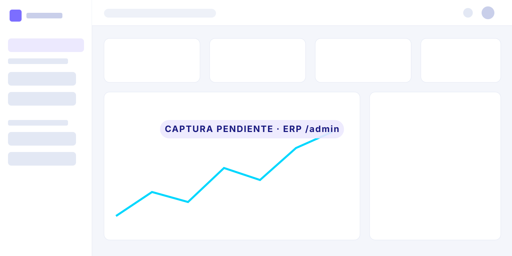

# 1. Acceso y navegación del panel ERP

El panel ERP es la consola central desde la que se administran los hospitales, sus módulos y sus cuentas. Este capítulo explica cómo ingresar y cómo moverse por el panel.

## 1.1 Ingreso con verificación en dos pasos

El acceso al panel `/admin` exige **verificación en dos pasos (MFA)** con una aplicación autenticadora que genere códigos de un solo uso (TOTP).

Correo y contraseña›
Configurar MFA (1.ª vez)›
Código de 6 dígitos›
Escritorio

### Primer ingreso: configurar MFA

<ol class="pasos">
<li>Escriba su <strong>correo</strong> y <strong>contraseña</strong> en la pantalla de inicio de sesión y confirme.</li>
<li>El sistema muestra un <strong>código QR</strong> y una clave de texto. Escanee el QR con su aplicación autenticadora.</li>
<li>Escriba el <strong>código de 6 dígitos</strong> que genera la aplicación para confirmar la configuración.</li>
</ol>

!!! important "Importante"
    Guarde la clave de texto en un lugar seguro. Si pierde el dispositivo, un administrador debe restablecer su MFA.

!!! tip "Consejo"
    En los siguientes ingresos solo se le pedirá el código vigente de su aplicación autenticadora.

## 1.2 Estructura del panel

<figure class="captura">

12
34

<figcaption>Figura 1. Escritorio del panel ERP (captura de muestra).</figcaption></figure>

<ol class="leyenda">
<li><strong>Menú lateral.</strong> Agrupa las opciones en Hospital, Usuarios, Reportes y Auditoría.</li>
<li><strong>Búsqueda.</strong> Localiza páginas y cuentas con <kbd>Ctrl</kbd> + <kbd>K</kbd>.</li>
<li><strong>Notificaciones y menú de usuario.</strong> Atajo <kbd>N</kbd> para abrir las notificaciones.</li>
<li><strong>Indicadores.</strong> Resumen del estado de hospitales y cuentas.</li>
</ol>

### Opciones del menú lateral

| Grupo | Opción | Para qué sirve |
|---|---|---|
| — | **Escritorio** | Resumen general del sistema. |
| Hospital | **Datos del hospital** | Identidad institucional y configuración del hospital. |
| Hospital | **Módulos** | Activar o desactivar módulos del HIS y de SIGARH. |
| Usuarios | **Usuarios del hospital** | Cuentas de cada hospital. |
| Usuarios | **Administradores** | Cuentas administrativas centrales. |
| Reportes | **Reporte mensual** | Resumen mensual del sistema. |
| Reportes | **Exportar datos** | Descarga de información en CSV. |
| Auditoría | **Auditoría del sistema** | Eventos de todo el ERP. |
| Auditoría | **Auditoría del hospital** | Eventos de un hospital concreto. |

## 1.3 Atajos y preferencias

| Acción | Atajo |
|---|---|
| Buscar páginas o cuentas | <kbd>Ctrl</kbd> + <kbd>K</kbd> (<kbd>Cmd</kbd> + <kbd>K</kbd> en Mac) |
| Abrir notificaciones | <kbd>N</kbd> |
| Cambiar modo claro / oscuro | <kbd>Shift</kbd> + <kbd>D</kbd> |
| Mostrar la ayuda de atajos | <kbd>?</kbd> |

!!! note "Nota"
    Las cuentas de **solo lectura** pueden consultar todo el panel, pero el sistema rechaza cualquier intento de crear, editar o eliminar datos.

## 1.4 Campos de ejemplo (formato de tabla de campos)

| Campo | Obligatorio | Descripción |
|---|:-:|---|
| Correo | Sí | Dirección con la que se inicia sesión. |
| Contraseña | Sí | Debe cumplir los requisitos que muestra la pantalla. |
| Código MFA | Sí | Código de 6 dígitos de la aplicación autenticadora. |
| Recordar dispositivo | No | Ejemplo de campo opcional. |
