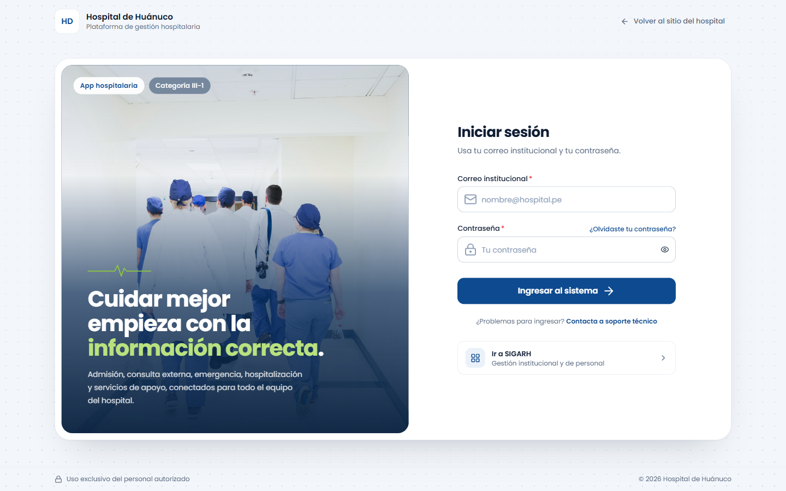

# 2. Inicio de sesión

## 2.1 Ingreso al HIS y a SIGARH

Ambos paneles usan el mismo formulario. Solo cambia el texto del botón (**Ingresar al sistema** en el HIS e **Ingresar a SIGARH** en SIGARH).

<figure class="captura">

<figcaption>Figura 1. Inicio de sesión del Panel Hospitalario.</figcaption></figure>

<ol class="pasos">
<li>Abra la dirección de su panel (<code>/app/login</code> para el HIS, <code>/sigarh/login</code> para SIGARH).</li>
<li>Escriba su <strong>correo institucional</strong>, por ejemplo <code>nombre@hospital.pe</code>.</li>
<li>Escriba su <strong>contraseña</strong>. Con el ícono del ojo puede mostrarla u ocultarla. Si el teclado tiene activada la tecla de mayúsculas, el sistema muestra el aviso <em>Bloq Mayús está activado</em>.</li>
<li>Pulse el botón de ingreso. Mientras el sistema verifica, el botón dice <em>Verificando credenciales…</em>.</li>
<li>Si los datos son correctos aparece el mensaje <em>Login exitoso</em> con su rol y su nombre, y se abre el escritorio de su panel.</li>
</ol>

| Campo | Obligatorio | Descripción |
|---|:-:|---|
| Correo institucional | Sí | Debe tener formato de correo. Si no, el sistema indica: *Revisa el formato del correo (ej. nombre@hospital.pe).* |
| Contraseña | Sí | Si queda vacía, el sistema indica: *Ingresa tu contraseña.* |

!!! tip "Consejo"
    Si olvidó su contraseña, use el enlace **¿Olvidaste tu contraseña?** o **Contacta a soporte técnico**. Ambos llevan al portal de atención al cliente de Techquk.

!!! note "Nota"
    Si el hospital está inactivo, o el sistema no logra cargar su configuración, el botón de ingreso aparece deshabilitado. Comuníquese con soporte técnico.

## 2.2 Ingreso al ERP con verificación en dos pasos

El panel ERP exige, además de la contraseña, un **código de 6 dígitos** generado por una aplicación autenticadora en el teléfono. Esto se llama verificación en dos pasos (MFA).

Correo y contraseña›
Paso 2 de 2: código de 6 dígitos›
Escritorio del ERP

### Primer ingreso: configurar la aplicación autenticadora

<figure class="captura">

<figcaption>Figura 2. Paso <em>Escanea el código</em> de la verificación en dos pasos.</figcaption></figure>

<ol class="pasos">
<li>Escriba su <strong>correo electrónico</strong> y <strong>contraseña</strong> y pulse <strong>Iniciar sesión</strong>. Si marca <strong>Recordarme</strong>, el sistema guardará únicamente su correo en este dispositivo; nunca la contraseña ni la sesión.</li>
<li>En el paso <strong>Instala la app</strong>, instale en su teléfono Google Authenticator, Microsoft Authenticator o Authy y pulse <strong>Ya la tengo</strong>.</li>
<li>En el paso <strong>Escanea el código</strong>, escanee el código QR con la aplicación. Si no puede escanearlo, escriba manualmente la clave que aparece debajo del QR. Luego pulse <strong>Ya lo escaneé</strong>.</li>
<li>En el paso <strong>Confirma</strong>, escriba el código de 6 dígitos que muestra la aplicación y pulse <strong>Verificar y continuar</strong>. El código se completa solo al digitar el sexto número.</li>
</ol>

!!! important "Importante"
    Guarde la clave manual en un lugar seguro. Si pierde el teléfono, otro administrador debe restablecer su verificación (ver el manual ERP-01). **Un administrador no puede restablecer su propia verificación**, por eso conviene que el hospital mantenga al menos dos cuentas administradoras.

### Ingresos siguientes

Después de escribir correo y contraseña aparece **Verificación en dos pasos**. Abra su aplicación autenticadora, escriba el código vigente de 6 dígitos y pulse **Verificar y continuar**. El código cambia cada 30 segundos.

Si el código es incorrecto o venció, el sistema muestra *Código incorrecto o expirado.* y limpia los casilleros; escriba el código nuevo. Con **Usar otra cuenta** vuelve al paso del correo y la contraseña.

## 2.3 Intentos fallidos y bloqueo temporal

Si escribe mal sus credenciales varias veces seguidas, el sistema bloquea temporalmente nuevos intentos y muestra *Demasiados intentos fallidos. Espera unos minutos antes de volver a intentar.* El bloqueo es por ventanas de 15 minutos: con el mismo correo desde el mismo equipo se permiten 5 intentos fallidos. Espere unos minutos y vuelva a intentar con los datos correctos.

## 2.4 Duración de la sesión

- La sesión se mantiene abierta y se renueva mientras usted trabaja.
- Como medida de seguridad, **a las 24 horas de haber ingresado** el sistema pide iniciar sesión de nuevo, aunque esté trabajando. Se muestra el mensaje *La sesión alcanzó su duración máxima; vuelve a iniciar sesión.*
- Para terminar antes, use **Cerrar sesión** (ver el capítulo 5).
