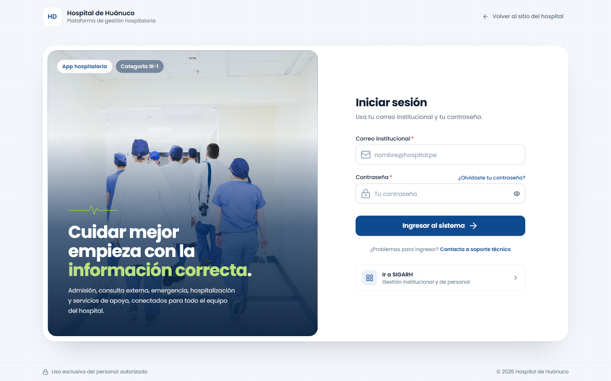

# 3. Navegación

Los tres paneles comparten la misma estructura: un menú lateral a la izquierda, una barra superior y el área de trabajo en el centro.

## 3.1 Estructura de la pantalla

<figure class="captura">

<figcaption>Figura 3. Estructura general del Panel Hospitalario.</figcaption></figure>

<ol class="leyenda">
<li><strong>Menú lateral.</strong> Muestra el nombre del hospital y los grupos de opciones que su perfil permite. Pulse un grupo para desplegar sus pantallas.</li>
<li><strong>Contraer / Expandir menú.</strong> Reduce el menú a íconos para ganar espacio de trabajo.</li>
<li><strong>Barra superior.</strong> Búsqueda, pendientes o notificaciones, ajustes y menú de usuario.</li>
<li><strong>Área de trabajo.</strong> Aquí se abre la pantalla elegida. El primer elemento del menú, <strong>Escritorio</strong>, vuelve a la pantalla de inicio.</li>
</ol>

## 3.2 Barra superior por panel

| Elemento | HIS | SIGARH | ERP |
|---|:-:|:-:|:-:|
| Búsqueda de pantallas | Sí | Sí | Sí |
| Búsqueda de pacientes (por nombre o DNI) | Sí | No | No |
| Búsqueda de empleados (por nombre o DNI) | No | Sí | No |
| Búsqueda de cuentas | No | No | Sí |
| Pendientes de hoy | Sí | No | No |
| Notificaciones | No | Sí | Sí |
| Ajustes | Sí | No | No |
| Menú de usuario (Mi perfil, Cerrar sesión) | Sí | Sí | Sí |

## 3.3 Búsqueda

En el HIS, la búsqueda se abre con el botón de la barra superior o con <kbd>Ctrl</kbd> + <kbd>K</kbd>.

<ol class="pasos">
<li>Escriba al menos <strong>2 letras</strong>: el nombre de una pantalla, o el nombre o DNI de un paciente.</li>
<li>El sistema muestra hasta 8 resultados agrupados en <strong>Pantallas</strong> y <strong>Pacientes</strong>.</li>
<li>Elija un resultado para abrirlo. Si no hay coincidencias, aparece <em>Sin resultados para esta búsqueda.</em></li>
</ol>

!!! note "Nota"
    Los pacientes solo se buscan si su perfil tiene acceso al módulo de **Admisión**. Las pantallas que aparecen son únicamente las que su perfil puede abrir.

## 3.4 Pendientes de hoy (HIS)

El ícono de pendientes abre el panel **Pendientes de hoy**, que resume las tareas que requieren su atención según su perfil. Puede incluir:

- citas por atender hoy,
- emergencias en atención,
- órdenes de laboratorio pendientes,
- recetas pendientes.

Pulse un elemento para abrir directamente el módulo correspondiente. Si no hay tareas, el panel indica *Sin pendientes por ahora*.

## 3.5 Notificaciones (SIGARH y ERP)

En SIGARH y en el ERP, el ícono de la campana abre las notificaciones. Un punto rojo con el número indica cuántas hay sin leer. En el ERP use <strong>Marcar todas como leídas</strong> para limpiarlas de una vez, y <strong>Cargar más</strong> para ver las anteriores. El contador se actualiza solo cada 45 segundos.

## 3.6 Atajos de teclado del ERP

El ERP tiene atajos para moverse sin usar el ratón. Se explican en el manual ERP-01 (capítulo de herramientas complementarias).
