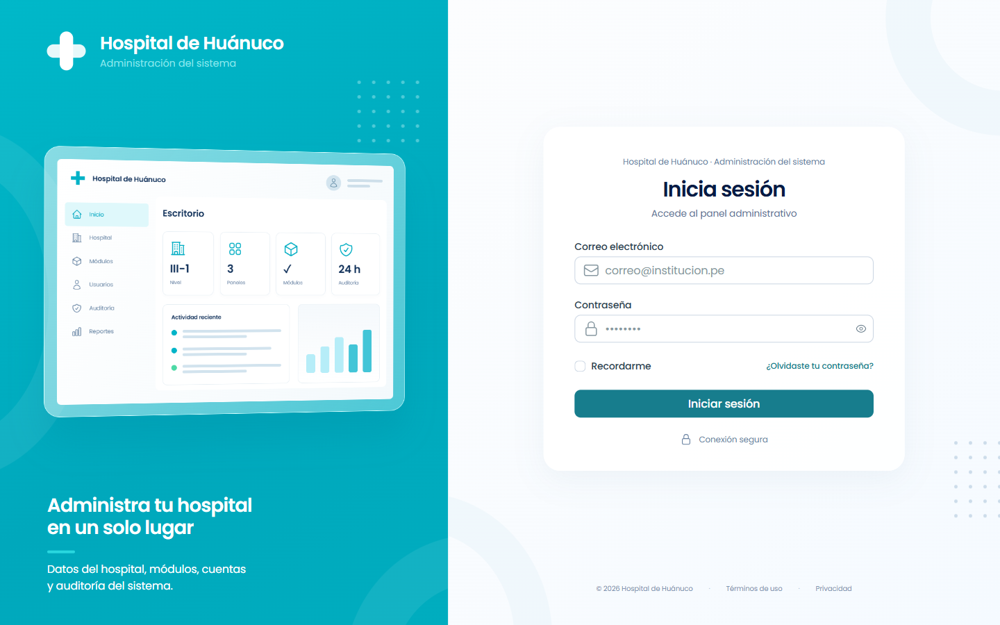
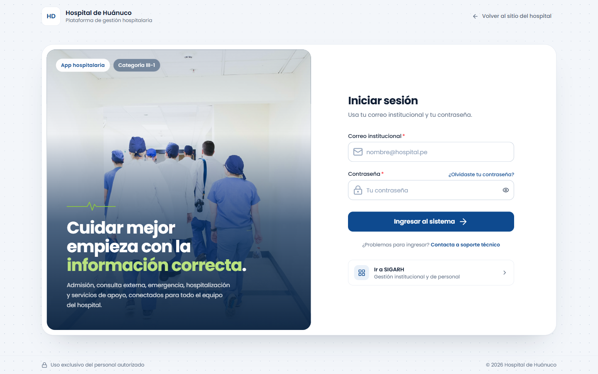

# 4. Mi perfil y contraseña

Para abrir su perfil, pulse su nombre en la barra superior y elija **Mi perfil**.

## 4.1 Requisitos de una contraseña

Toda contraseña nueva debe cumplir **todos** estos requisitos. Al escribirla, la pantalla marca cada uno cuando se cumple:

| Requisito | Ejemplo |
|---|---|
| 8 o más caracteres | `Hospital2026!` |
| Al menos una minúscula | `a` |
| Al menos una mayúscula | `H` |
| Al menos un número | `2` |
| Al menos un carácter especial | `!` |

!!! tip "Consejo"
    Use una contraseña que solo conozca usted y no la comparta. Las acciones realizadas con su cuenta quedan registradas a su nombre en la auditoría del sistema.

## 4.2 Perfil en el ERP

<figure class="captura">

<figcaption>Figura 4. Mi perfil en el panel ERP.</figcaption></figure>

| Campo | Obligatorio | Descripción |
|---|:-:|---|
| Nombre | Sí | Su nombre en el sistema. |
| Correo electrónico | Sí | Con el que inicia sesión. |
| Contraseña actual | Condicional | Solo se pide si cambia el correo o la contraseña. |
| Nueva contraseña | No | Debe cumplir los requisitos de la sección 4.1. |
| Confirmar nueva contraseña | No | Debe ser idéntica a la nueva contraseña. |

<ol class="pasos">
<li>Modifique los datos que necesite.</li>
<li>Si cambia el correo o la contraseña, escriba su <strong>contraseña actual</strong>.</li>
<li>Pulse <strong>Guardar cambios</strong>.</li>
</ol>

Si cambió la contraseña, el sistema cierra su sesión y lo lleva al inicio de sesión con el aviso *Tu contraseña se actualizó correctamente*. Ingrese con la nueva contraseña.

## 4.3 Perfil en el HIS

En el HIS, **Mi perfil** permite administrar los datos de acceso y la seguridad de la cuenta. Tiene estas secciones:

- **Ficha profesional.** Solo lectura. Aparece cuando su cuenta está vinculada a un empleado y muestra los datos de su registro en Recursos Humanos: nombre, DNI, cargo, profesión y número de colegiatura.
- **Datos de acceso.** Nombre completo y correo electrónico.
- **Seguridad.** Cambio de contraseña: contraseña actual, nueva y confirmación. Al actualizarla, tendrá que iniciar sesión nuevamente.
- **Firma electrónica** (ver 4.5).

## 4.4 Perfil en SIGARH

Permite actualizar el **nombre completo** y el **correo electrónico**, y cambiar la contraseña (**Contraseña actual**, **Nueva contraseña** y **Confirmar nueva contraseña**). Si deja la nueva contraseña en blanco, no se modifica.

!!! important "Importante"
    En SIGARH, al cambiar la contraseña **se cierra la sesión en todos los dispositivos**, no solo en el que está usando.

## 4.5 Firma electrónica (HIS)

Los profesionales que firman atenciones registran aquí su firma. La firma se imprime en la **Ficha de Atención**, y el **PIN** se pide cada vez que usted cierra una atención médica o de emergencia.

<figure class="captura">

<figcaption>Figura 5. Sección de firma electrónica en Mi perfil (HIS).</figcaption></figure>

| Campo | Descripción |
|---|---|
| Imagen de tu firma | Archivo PNG, JPG o WebP de hasta **500 KB**. Botones **Subir firma** / **Cambiar firma** y **Quitar**. |
| PIN (6 dígitos) | Exactamente 6 números. Si ya tiene uno, el campo se llama **Nuevo PIN (6 dígitos)**. |
| Confirmar PIN | Debe coincidir con el PIN. |
| Contraseña actual | Obligatoria para confirmar un cambio de PIN. |

<ol class="pasos">
<li>Pulse <strong>Subir firma</strong> y elija la imagen de su firma. Verá una vista previa.</li>
<li>Escriba el <strong>PIN</strong> de 6 dígitos y repítalo en <strong>Confirmar PIN</strong>.</li>
<li>Escriba su <strong>contraseña actual</strong>.</li>
<li>Pulse <strong>Guardar firma</strong>.</li>
</ol>

Mensajes que puede ver: *El PIN debe tener exactamente 6 dígitos*, *Los PIN no coinciden*, *Ingresa tu contraseña actual para confirmar el PIN* y *Selecciona una imagen PNG, JPG o WebP de hasta 500 KB.*

!!! important "Importante"
    No comparta su PIN. Quien lo conozca puede cerrar atenciones clínicas con su firma.
