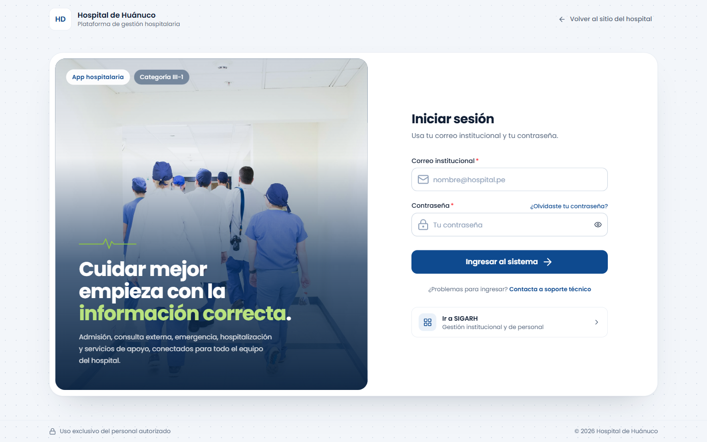

# 5. Ajustes y cierre de sesión

## 5.1 Ajustes del Panel Hospitalario

El engranaje de la barra superior abre **Ajustes**, donde cada usuario personaliza su espacio de trabajo.

<figure class="captura">

<figcaption>Figura 6. Ajustes del Panel Hospitalario.</figcaption></figure>

### Preferencias de visualización

| Opción | Efecto |
|---|---|
| **Menú lateral compacto** | Inicia con el menú plegado para disponer de más espacio. |
| **Tablas compactas** | Reduce el espacio entre filas para ver más registros. |
| **Reducir movimiento** | Evita animaciones y desplazamientos suaves. |

<ol class="pasos">
<li>Active o desactive los interruptores que desee.</li>
<li>Pulse <strong>Guardar preferencias</strong>. Mientras haya cambios sin guardar verá la etiqueta <em>Cambios sin guardar</em>.</li>
<li>Para volver a los valores originales, pulse <strong>Restablecer</strong>.</li>
</ol>

!!! note "Nota"
    Las preferencias se guardan para su cuenta y su hospital **en este navegador**. Si usa otro equipo u otro navegador, deberá configurarlas de nuevo.

### Mi cuenta y accesos de configuración

- **Mi cuenta** muestra su nombre, correo y rol, y el botón **Editar perfil y contraseña**.
- **Configuración y catálogos** muestra accesos directos a catálogos y a la configuración (servicios, diagnósticos, paquetes, catálogos de facturación, empleados y auditoría general) **solo si su perfil tiene esos permisos**. Si no los tiene, aparece *Sin accesos de configuración*.

## 5.2 Cerrar sesión

<ol class="pasos">
<li>Pulse su nombre en la barra superior.</li>
<li>Elija <strong>Cerrar sesión</strong>.</li>
</ol>

Si el servidor no pudo confirmar la revocación de la sesión, el inicio de sesión muestra un aviso en amarillo. **Si usó un equipo compartido, cambie su contraseña por seguridad.**

!!! important "Importante"
    En equipos compartidos, cierre siempre la sesión al terminar y no use la opción **Recordarme** del ERP.
