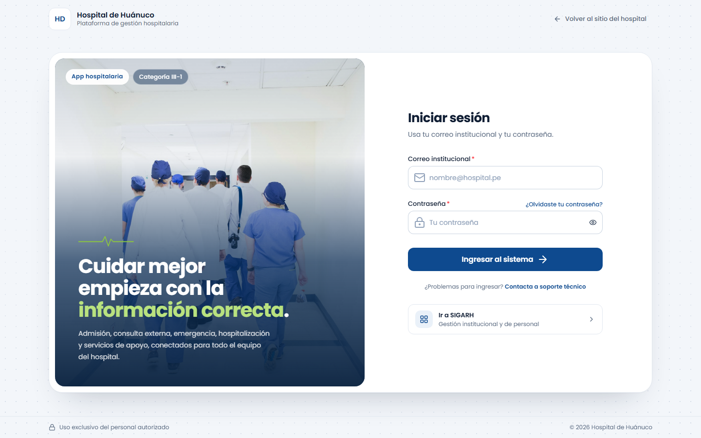

# 2. Pacientes

El **directorio de pacientes** es la base de toda la atención: cada cita, atención, receta y cobro se asocia a un paciente con su **historia clínica**. Ruta: **Panel Hospitalario › Admisión › Pacientes** (*Directorio del hospital*).

## 2.1 Buscar un paciente

<figure class="captura">

<figcaption>Figura 1. Directorio de pacientes.</figcaption></figure>

<ol class="pasos">
<li>Escriba en el buscador <strong>Buscar por DNI, historia clínica o nombre</strong>. Se necesitan <strong>al menos 2 caracteres</strong>: <em>Ingresa al menos 2 caracteres</em>.</li>
<li>La tabla muestra <strong>DNI</strong>, <strong>Historia clínica</strong>, <strong>Paciente</strong>, <strong>Edad</strong> y <strong>Seguro</strong>.</li>
<li>Con <strong>Ver ficha</strong> o <strong>Editar datos</strong> se abre la ficha del paciente (ambas opciones llevan a la misma pantalla, sección 2.3).</li>
</ol>

!!! tip "Consejo"
    **Busque siempre antes de registrar.** Un paciente duplicado genera dos historias clínicas y deja su historial dividido.

## 2.2 Registrar un paciente nuevo

Pulse **Nuevo paciente**. Los campos con asterisco (\*) son obligatorios. El **número de historia clínica se genera automáticamente**; mientras se completa la ficha, un panel lateral muestra el resumen y cuántos datos faltan.

<figure class="captura">

<figcaption>Figura 2. Registro de un paciente.</figcaption></figure>

### Paso 1: Identificación

<ol class="pasos">
<li>Elija el <strong>Tipo de documento</strong>: <strong>DNI</strong>, <strong>Carnet de Extranjería</strong>, <strong>Pasaporte</strong> o <strong>Partida de Nacimiento</strong>.</li>
<li>Escriba el <strong>N.° de documento</strong>. Para un DNI, pulse <strong>Buscar por DNI</strong>: el sistema comprueba que el paciente <strong>no exista</strong> y, si no existe, <strong>autocompleta</strong> nombres, apellidos, fecha de nacimiento y sexo desde el servicio de identidad.</li>
<li>Revise los datos traídos. Complételos o corríjalos si hace falta.</li>
</ol>

| Situación | Mensaje | Qué hacer |
|---|---|---|
| El DNI no tiene 8 dígitos | *Ingresa un DNI válido (8 dígitos)* | Corrija el número. |
| El paciente ya existe | *Ya existe un paciente registrado con este documento: …* | **No lo registre de nuevo**: búsquelo en el directorio y abra su ficha. |
| Falta el documento | *El documento es obligatorio* | Escríbalo, o marque NN si no está identificado. |

!!! important "Importante"
    **Paciente no identificado (NN).** Si no se conoce la identidad (por ejemplo, una emergencia), marque **No Identificado (NN)**. Se deshabilitan el tipo y el número de documento y la ficha queda como **NN**. Cuando se conozcan sus datos, edite la ficha.

!!! note "Nota"
    El registro **manual** del número de historia clínica **no está disponible**: la historia siempre se genera sola, y la pantalla lo avisa.

### Paso 2: Datos personales

| Campo | Obligatorio | Descripción |
|---|:-:|---|
| Apellido paterno | Sí | *El apellido paterno es obligatorio*. |
| Apellido materno | Sí | *El apellido materno es obligatorio*. |
| Primer nombre | Sí | *El primer nombre es obligatorio*. |
| Segundo nombre | No | Opcional. |
| Fecha de nacimiento | Sí | *La fecha de nacimiento es obligatoria*. El sistema calcula la edad. |
| Sexo | Sí | **Masculino** o **Femenino**. *El sexo es obligatorio*. |
| Estado civil | No | Soltero(a), Casado(a), Viudo(a), Divorciado(a), Conviviente. Por defecto *No se sabe*. |
| Grado de instrucción | No | Ninguno, Primaria, Secundaria, Técnica o Superior. |
| Etnia | No | Mestizo, Indígena, Afrodescendiente, Blanco, Otro. Por defecto *No especifica*. |
| Idioma | No | Español (por defecto), Quechua, Aimara u Otro. |
| Ocupación | No | Estudiante, Empleado, Independiente, Desempleado. Por defecto *Otros no especificados*. |

### Paso 3: Contacto y domicilio

| Campo | Descripción |
|---|---|
| Teléfono | Con la opción de marcarlo como **WhatsApp**. |
| Email | Correo del paciente. |
| Dirección | Dirección del domicilio. |
| Departamento, Provincia y Distrito | Listas dependientes: al elegir el departamento se cargan sus provincias, y al elegir la provincia, sus distritos. |
| Centro poblado y País | País: *Perú* por defecto. |

En la pestaña **Lugar de nacimiento** se repite el mismo bloque. Si el lugar de nacimiento es el mismo que el domicilio, no hace falta llenarlo.

### Guardar

Pulse **Registrar Paciente**. Si falta algún dato obligatorio, el sistema lo indica arriba. Al guardar, aparece *Paciente registrado correctamente: nombre (HC: número)* y la pantalla vuelve al directorio. **Anote o imprima el número de historia clínica**: lo necesitará en Archivo Clínico (manual HIS-11).

## 2.3 Ver y editar la ficha

La ficha reúne los mismos datos del registro, organizados en **Identificación**, **Datos personales**, **Contacto**, **Domicilio** y **Seguro**, con un resumen lateral (*Estado*: **Identificado** o **NN**, y **Campos completos**, por ejemplo 8/10).

<ol class="pasos">
<li>Abra al paciente con <strong>Ver ficha</strong> o <strong>Editar datos</strong>.</li>
<li>Modifique los datos que necesite. Los obligatorios siguen siendo apellidos, primer nombre, fecha de nacimiento y sexo (*El primer nombre es requerido*, etc.).</li>
<li>En <strong>Seguro</strong> elija el <strong>Tipo de seguro</strong> y escriba el <strong>N.° de seguro</strong>.</li>
<li>Pulse <strong>Guardar Cambios</strong>.</li>
</ol>

!!! important "Importante"
    **El DNI no se puede modificar si el paciente está identificado.** Los cambios de la ficha **se reflejan en todos los módulos** del HIS: citas, caja, farmacia, historia clínica. La edad se calcula sola a partir de la fecha de nacimiento.

