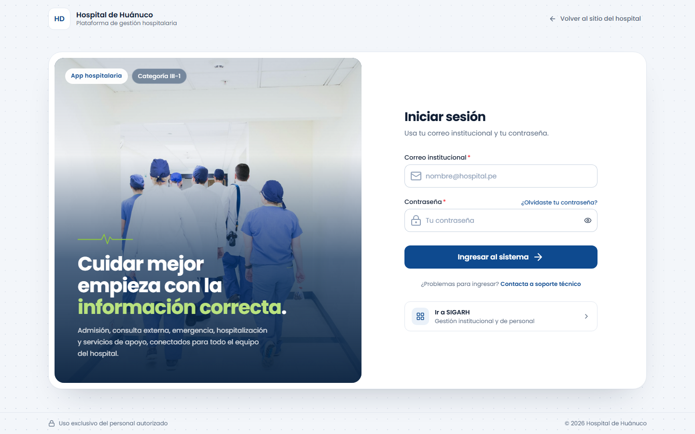

# 3. Agendamiento y pacientes citados

## 3.1 Cómo nace una cita

Una cita siempre ocupa un **cupo** de una **programación médica**, y la programación existe porque un **rol de turno fue aprobado** en SIGARH (manual SIG-02).

Rol aprobado (SIG-02)›
Programación médica›
Cupos›
Cita

Estados de una cita:

| Estado | Significado |
|---|---|
| **Separada** | El cupo está reservado, pero la cita aún no se confirmó. |
| **Confirmada** | El paciente confirmó su asistencia (manual HIS-02). |
| **Atendida** | El médico atendió y cerró la atención. |
| **Cancelada** | La cita fue cancelada. |
| **No asistió** | El paciente no se presentó. |

## 3.2 Agendamiento de citas

Ruta: **Admisión › Agendamiento** (*Disponibilidad médica y asignación de cupos*).

<figure class="captura">

<figcaption>Figura 3. Agendamiento de citas.</figcaption></figure>

<ol class="leyenda">
<li><strong>Filtros.</strong> <em>Servicio</em> (<em>Todos los servicios</em>), <em>Especialidad</em> (<em>Todas las especialidades</em>) y <em>Fecha</em>, con <strong>Buscar</strong> y <strong>Limpiar</strong>.</li>
<li><strong>Indicadores.</strong> Programaciones activas, Total cupos, Cupos disponibles y Cupos ocupados.</li>
<li><strong>Consultorios / Programaciones.</strong> Lista de programaciones de la fecha; cada una indica si está <em>Activa</em> o <em>Inactiva</em>.</li>
<li><strong>Cupos.</strong> Los cupos de la programación elegida, numerados y con la etiqueta <em>N disponibles · N ocupados</em>.</li>
</ol>

### Citar a un paciente

<ol class="pasos">
<li>Elija la <strong>fecha</strong> y filtre por servicio o especialidad. Si no aparece nada: <em>No hay programaciones para estos filtros</em>.</li>
<li>Seleccione una programación. Si no hay cupos: <em>No hay cupos disponibles para esta programación</em>.</li>
<li>En el cupo libre pulse <strong>Citar</strong>. Se abre <strong>Citar paciente</strong>.</li>
<li>Busque al paciente por <strong>DNI</strong> (<em>Busca un paciente por DNI para continuar</em>). Si se equivocó de paciente, use <strong>Quitar paciente</strong>.</li>
<li>Si el paciente <strong>no está registrado</strong>, complete el registro rápido —<strong>Primer nombre</strong>, <strong>Apellido paterno</strong>, <strong>Apellido materno</strong>, <strong>Fecha de nacimiento</strong> y <strong>Sexo</strong>, todos obligatorios— y pulse <strong>Registrar y usar este paciente</strong>. Complete la ficha después (capítulo 2).</li>
<li>En <strong>Datos de la cita</strong>, indique el <strong>Tipo de consulta</strong> (por ejemplo, <em>Primera vez</em>, <em>Control</em>), la <strong>Observación</strong>, la <strong>Fuente de financiamiento</strong> y el <strong>Producto / Plan</strong>. Por defecto se usa el seguro del paciente (<em>Sin seguro / el del paciente</em>).</li>
<li>Pulse <strong>Guardar cita</strong>. En el cupo, el botón cambia a <strong>Ver cita</strong>.</li>
</ol>

| Situación | Mensaje | Qué hacer |
|---|---|---|
| El paciente ya tiene cita en esa programación | *El paciente ya tiene una cita en esta programación* | Elija otra programación o revise su cita. |
| El cupo se ocupó mientras tanto | *Ese cupo ya está ocupado* | Elija otro cupo libre. |
| El cupo ya pasó | *Ese cupo ya pasó; elige un horario posterior a la hora actual* | Elija una hora posterior a la actual (hora de Lima). |
| La programación no está activa o no existe | *La programación no existe o no está activa* | Actualice la pantalla. |
| La programación ya no tiene rol aprobado | *La programación requiere un rol aprobado vigente.* | Revise el rol en SIGARH (SIG-02). |

!!! important "Importante"
    No se puede citar en el pasado: un cupo de hoy se acepta solo si su hora de inicio es posterior a la hora actual. Si no encuentra una programación esperada, **verifique en SIGARH que el rol esté aprobado** (SIG-02).

## 3.3 Pacientes citados

Ruta: **Admisión › Citados** (*Agenda de admisión*). Sirve para consultar las citas, imprimir el ticket y **reprogramar**.

<figure class="captura">

<figcaption>Figura 4. Pacientes citados.</figcaption></figure>

### Buscar citas

Use los filtros **DNI**, **Cuenta**, **Historia clínica**, **Paciente** (apellido), **Desde**, **Hasta**, **Médico** y **Estado**, y pulse **Buscar citas** (o **Limpiar**). La lista muestra 15 citas por página con Paciente (DNI e historia), Fecha y hora, Atención, Seguro y Estado. Sin resultados: *No hay citas para los filtros seleccionados*.

### Acciones por cita

| Acción | Efecto |
|---|---|
| **Ver detalle** | Muestra paciente, N.° de cuenta, DNI, teléfono, historia, especialidad, servicio, médico, fecha y hora, seguro y estado. |
| **Imprimir ticket** | Abre el comprobante de la cita para imprimirlo. |
| **Reprogramar** | Cambia la cita a otra fecha, programación y cupo. **No está disponible** para citas atendidas o canceladas. |

Una cita con la etiqueta **Reprogramar** (en amarillo) está **en riesgo**: su médico dejó de estar programado ese día, por ejemplo, por vacaciones o licencia aprobada (manual SIG-01). Reprograme esas citas cuanto antes.

### Reprogramar una cita

<ol class="pasos">
<li>Pulse <strong>Reprogramar</strong> en la cita.</li>
<li>Elija la <strong>Fecha destino</strong>.</li>
<li>Elija la <strong>Programación autorizada en SIGARH</strong> (médico, especialidad y turno).</li>
<li>Elija el <strong>Cupo libre</strong>.</li>
<li>Escriba, si desea, un <strong>Mensaje para el paciente</strong> (hasta 500 caracteres).</li>
<li>Pulse <strong>Reprogramar</strong>.</li>
</ol>

### Reprogramar varias citas a la vez

Marque las citas (casillas de la primera columna; solo se pueden marcar las no atendidas ni canceladas) y pulse **Reprogramar selección**. En **Reprogramación en bloque** elija la fecha, la programación y el mensaje: **los primeros cupos libres se asignan de forma consecutiva** a las citas marcadas.

| Regla | Mensaje |
|---|---|
| Faltan datos. | *Selecciona una programación y un cupo libre* |
| La programación no tiene suficientes cupos. | *Solo hay N cupos libres para N citas* |
| La cita ya tiene **triaje**. | *La cita ya tiene triaje; no puede trasladar su registro clínico a otra programación.* / *No puede reprogramar citas que ya tienen triaje.* |
| La cita está atendida o cancelada. | *No se puede reprogramar una cita atendida / cancelada* |
| La programación no está autorizada. | *La programación seleccionada no está autorizada en SIGARH* |
| El horario ya se ocupó. | *El horario ya no está disponible* |
