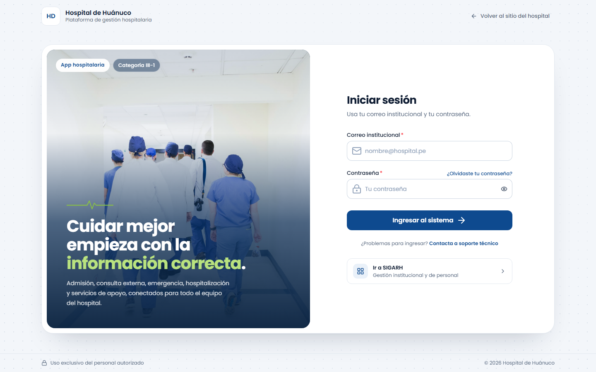

# 4. Programación médica

La **programación médica** son las jornadas autorizadas de cada médico para Consulta Externa: de ella salen los **cupos** que Admisión agenda (capítulo 3). Ruta: **Admisión › Programación Médica** (*Jornadas autorizadas para consulta externa*).

## 4.1 De dónde sale una programación

| Origen | Cómo se mantiene |
|---|---|
| **De un rol aprobado en SIGARH** | La genera y la mantiene el sistema al **aprobar el rol de turno** (manual SIG-02). Si el rol cambia, la programación se actualiza sola. |
| **Registrada a mano en el HIS** | La crea y la edita Admisión con **Agregar Programación** (sección 4.3). |

!!! important "Importante"
    **Una programación que proviene de un rol de SIGARH solo permite cambiar el consultorio, la modalidad, la visibilidad y la descripción.** Si intenta cambiar el horario, el médico o el estado, el sistema responde que eso se cambia **en el rol o con un cambio de turno** (manual SIG-01). Tampoco se puede eliminar desde aquí.

## 4.2 Consultar las programaciones

<figure class="captura">

<figcaption>Figura 5. Programación médica.</figcaption></figure>

- **Filtros:** **Año**, **Mes** (*Todos los meses*), **Servicio**, **Especialidad**, **Estado** (*Activa* / *Inactiva*) y **Código** (*Buscar código*). Use **Buscar**, **Limpiar** o **Actualizar**.
- **Indicadores:** Programaciones, Activas, Inactivas y Especialidades.
- **Tabla:** Código, Médico, Especialidad, Fecha y horario, Turno, **Modalidad** (*Presencial* o *Virtual*) y Estado. **Ver** abre la programación.

## 4.3 Agregar una programación manual

Pulse **Agregar Programación** (*Registra una nueva programación médica*). Seleccione **primero el servicio y la especialidad**: ellos determinan qué médicos se ofrecen.

| Campo | Obligatorio | Descripción |
|---|:-:|---|
| Servicio | Sí | *El servicio es requerido*. |
| Especialidad | Sí | Depende del servicio. *La especialidad es requerida*. |
| Médico | Sí | Solo los médicos con esa especialidad. *El médico es requerido*. |
| Fecha | Sí | *La fecha es requerida*. |
| Turno | Sí | **Mañana**, **Tarde** o **Noche**. |
| Hora de inicio / Hora de fin | Sí | Inicio y fin de la atención. La hora de fin debe ser posterior a la de inicio. |
| Tiempo promedio de atención (min) | No | Duración estimada por paciente: **se usa para calcular los cupos de citas**. |
| Consultorio | No | Si se indica, la programación aparece en el módulo de consultorio. |
| Descripción | No | Nota libre. |

!!! note "Nota"
    El sistema valida que el médico esté **dentro de su vigencia laboral** en la fecha elegida (ingreso y cese: manual SIG-01) y que la especialidad corresponda al servicio.

## 4.4 Ver, editar y cambiar el estado

Con **Ver** se abre la programación (título: el nombre del médico; subtítulo: la especialidad). Puede cambiar fecha, turno, horas, tiempo promedio, consultorio y descripción, y el **Estado**. Antes de cancelar una programación con citas, **reprograme las citas** desde *Citados* (capítulo 3) para no dejar pacientes sin médico.

| Estado | Cuándo usarlo |
|---|---|
| **Activo** | La programación está vigente y sus cupos se pueden agendar. |
| **Cancelado** | La jornada no se llevará a cabo. **Las programaciones canceladas no aparecen en consultorio.** |
| **Completado** | La atención de esa jornada ya terminó. |
