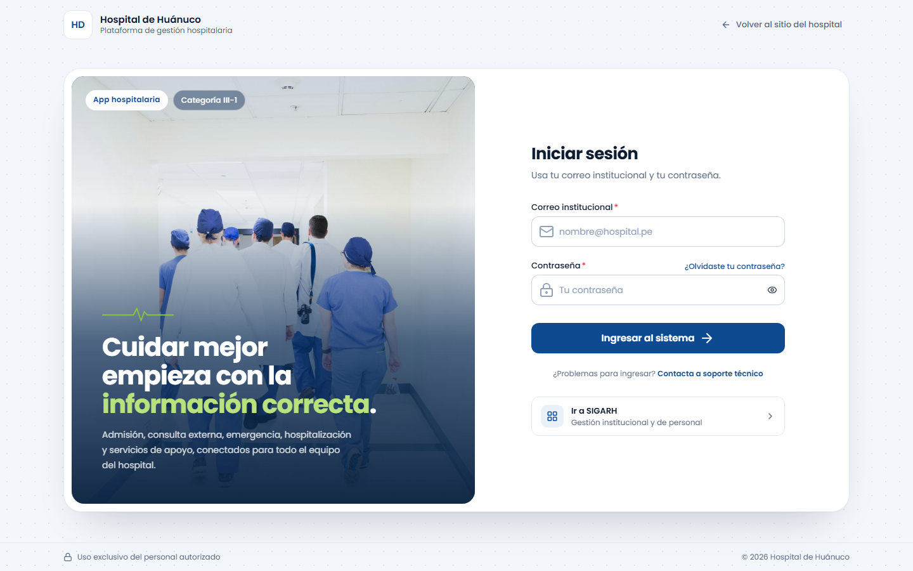

# 5. Altas, lista de espera, anuncios y mensajes

## 5.1 Altas de pacientes

Ruta: **Admisión › Altas** (*Cierre administrativo de atenciones finalizadas*). Es una pantalla **de solo lectura**: muestra las altas ya registradas en Hospitalización y Emergencia (manuales HIS-03 y HIS-04); aquí no se registran.

- **Filtros:** **Desde**, **Hasta** y **Paciente** (nombre o DNI), con **Buscar** y **Limpiar**.
- **Tabla:** **Origen** (*Hospitalización* o *Emergencia*), Paciente (con su DNI, o *Paciente NN*), N.° de atención, Fecha de alta, Servicio y Resumen. Sin resultados: *No se encontraron altas para los filtros seleccionados*.

## 5.2 Lista de espera

Ruta: **Admisión › Lista de Espera** (*Pacientes pendientes de atención o agendamiento*). Sirve para anotar al paciente que no encontró cupo, y atenderlo cuando se libere uno.

<figure class="captura">

<figcaption>Figura 6. Lista de espera.</figcaption></figure>

### Registrar a un paciente

<ol class="pasos">
<li>Pulse <strong>Registrar paciente</strong>. Se abre <em>Registrar en lista de espera</em>.</li>
<li>Escriba el <strong>DNI del paciente</strong> y pulse <strong>Buscar</strong>. Debe aparecer <em>Paciente encontrado</em> con su nombre; si no existe, regístrelo antes (capítulo 2).</li>
<li>Elija el <strong>Servicio</strong> y la <strong>Especialidad</strong> (opcionales).</li>
<li>Elija la <strong>Prioridad</strong>: <strong>Normal</strong> o <strong>Urgente</strong>.</li>
<li>Escriba el <strong>Motivo</strong> de la espera y pulse <strong>Registrar</strong>.</li>
</ol>

### Atender o cancelar

- Use las pestañas de estado: **Pendientes**, **Atendidos** y **Cancelados**. Busque por *Nombre o DNI*. Si no hay nadie: *No hay pacientes en este estado*.
- La tabla muestra Prioridad, Paciente, Servicio / Especialidad, Motivo y Registrado (fecha y hora).
- **Atender** abre *Atender a …*: *Puedes vincular una cita existente o marcar la atención directamente*. Elija la **Cita vinculada** (o *Sin vincular cita*) y pulse **Marcar atendido**.
- La **X** (*Cancelar registro*) retira al paciente de la espera.

## 5.3 Anuncios

Ruta: **Admisión › Anuncios** (*Comunicaciones para el personal hospitalario*). Un anuncio lo ven todos los usuarios del hospital.

<ol class="pasos">
<li>Pulse <strong>Nuevo anuncio</strong>.</li>
<li>Escriba el <strong>Título</strong> (hasta 150 caracteres) y el <strong>Contenido</strong>. Ambos son obligatorios.</li>
<li>Pulse <strong>Publicar anuncio</strong>.</li>
</ol>

Cada anuncio se muestra como una tarjeta con la etiqueta **Activo** o **Inactivo**. El botón del ojo **desactiva** un anuncio (deja de mostrarse) o lo **reactiva**. Marque **Ver inactivos** para incluir los desactivados. Mensajes: *No hay anuncios activos* / *No hay anuncios publicados*.

## 5.4 Mensajito

Ruta: **Admisión › Mensajito** (*Comunicación interna del equipo hospitalario*). Es una mensajería breve entre el personal.

- Las pestañas **Recibidos** y **Enviados** separan la bandeja. Los mensajes sin leer aparecen resaltados; use **Marcar como leído**. Si está vacía: *No tienes mensajes* / *No has enviado mensajes*.
- Pulse **Nuevo mensaje** (*Envía una comunicación a una persona o a todo un rol*). Elija el **Destinatario** —una persona (con su rol) o un rol completo—, escriba el **Mensaje** (hasta 500 caracteres, con contador) y pulse **Enviar mensaje**.

!!! tip "Consejo"
    Use **Anuncios** para avisos a todo el personal, y **Mensajito** para coordinar con una persona o un rol concreto.
