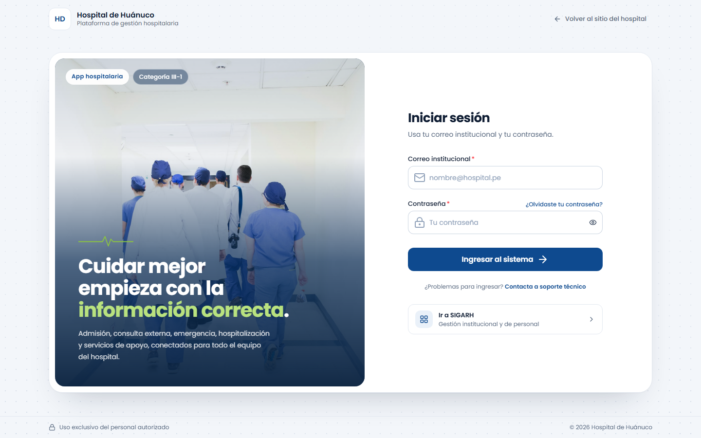

# 6. Turnero

El **Turnero** ordena la atención en filas: el paciente obtiene un **ticket** (en un kiosko o en la ventanilla), espera su llamado en una **pantalla** de sala y el personal lo **llama** desde su puesto. Tiene tres opciones en el menú: **Emisión**, **Llamado** y **Configuración**.

## 6.1 Servicios y prioridad

| Servicio | Prefijo del ticket |
|---|:-:|
| **Admisión** | A |
| **Caja** | C |
| **Farmacia** | F |
| **Triaje** | T |
| **Consultorio** | M |

La **atención preferente** (Ley N.° 28683) pasa por delante de la fila normal, y **dentro de cada grupo se respeta el orden de llegada**:

| Prioridad | Cómo se asigna |
|---|---|
| **Adulto mayor** | Automática: 60 años o más (por la fecha de nacimiento del paciente). |
| **Niña o niño** | Automática: menor de 12 años. |
| **Gestante** | La declara quien emite el ticket. |
| **Persona con discapacidad** | La declara quien emite el ticket. |

## 6.2 Emitir un ticket

Ruta: **Turnero › Emisión Ticket**. Sirve cuando el paciente se acerca al personal en lugar de usar el kiosko.

<figure class="captura">

<figcaption>Figura 7. Emisión de tickets.</figcaption></figure>

<ol class="pasos">
<li>Elija el <strong>Servicio</strong> (se muestra con su prefijo).</li>
<li>Si el paciente tiene DNI, escríbalo en <strong>DNI del paciente (opcional)</strong> y pulse <strong>Buscar</strong>. El sistema trae su nombre y <strong>sugiere la prioridad</strong> si corresponde. Use <strong>Quitar</strong> para descartar al paciente.</li>
<li>Si no tiene registro, escriba el <strong>Nombre a mostrar (si no tiene registro)</strong>.</li>
<li>Si es gestante o tiene discapacidad, elija la <strong>Atención preferente</strong> correspondiente.</li>
<li>Pulse <strong>Emitir ticket</strong>. Se muestra el número (por ejemplo, con la etiqueta <em>Preferente · Adulto mayor</em> si aplica).</li>
</ol>

| Situación | Mensaje | Qué hacer |
|---|---|---|
| El DNI no está registrado | *No hay paciente registrado con ese documento* | Registre al paciente (capítulo 2) o emita sin DNI. |
| Ticket de consultorio sin cita | *El turno de consultorio requiere una cita del día. Acérquese a Admisión.* | Agende primero la cita (capítulo 3). |

## 6.3 Llamar pacientes

Ruta: **Turnero › Llamado**. Cada puesto atiende una fila.

<ol class="pasos">
<li>Elija el <strong>Servicio</strong> que atiende.</li>
<li>Elija desde dónde llama: <strong>Llamo desde</strong> (su **ventanilla**) o, en Consultorio, el <strong>Consultorio (programación de hoy)</strong>.</li>
<li>Pulse <strong>Llamar siguiente</strong>; el botón indica cuántos hay en espera. También puede llamar a uno concreto con <strong>Llamar</strong> en la lista (Ticket, Paciente y hora de llegada).</li>
<li>La pantalla de sala anuncia el ticket. Cuando el paciente llegue, atiéndalo y ciérrelo con una de estas acciones.</li>
</ol>

| Acción | Cuándo |
|---|---|
| **Volver a llamar** | El paciente no responde al primer llamado. |
| **Atendido** | La atención terminó. |
| **No se presentó** | El paciente no vino. |
| **Derivar** | Pasa al paciente a otro servicio: elija el servicio destino y se crea un **nuevo ticket** (*Derivado: nuevo ticket …*) que **conserva la prioridad**. |
| **Volver a la cola** | Un ticket de hoy marcado como *No se presentó* regresa a la fila. |

| Mensaje | Qué significa |
|---|---|
| *Seleccione la ventanilla desde la que llama* | Elija su ventanilla antes de llamar. |
| *Seleccione la programación del consultorio* | En Consultorio, elija la programación de hoy. |
| *El ticket ya no está en cola* | Otro puesto ya lo llamó. |
| *Primero llame al paciente* | No se puede cerrar un ticket que no se llamó. |
| *El ticket ya fue cerrado* | Ya se marcó como atendido o no presentado. |
| *Seleccione un servicio distinto* | Al derivar, el destino debe ser otro servicio. |
| *Solo un ticket de hoy marcado como no presentado vuelve a la cola* | Solo se reincorpora lo de hoy. |

## 6.4 Configuración

Ruta: **Turnero › Configuración**. Puede no estar disponible para todos los perfiles.

### Ventanillas

Cada puesto de atención de Admisión, Caja, Farmacia o Triaje es una **ventanilla**. Elija el **Servicio**, escriba el **Nombre** (por ejemplo, *Ventanilla 1*) y pulse **Agregar**. Con **Desactivar** / **Activar** se retira o se reincorpora (*Activa* / *Inactiva*).

!!! note "Nota"
    **Consultorio no usa ventanillas**: toma el consultorio de la programación médica del día (*Consultorio usa el consultorio de la programación médica; no requiere ventanillas*).

### Dispositivos: kioskos y pantallas

Cada **kiosko** (donde el paciente toma su turno) y cada **pantalla** (televisor de sala) recibe un **enlace propio**: se abre una sola vez en ese equipo, funciona **sin iniciar sesión** y se puede revocar.

<ol class="pasos">
<li>En <strong>Dispositivos</strong>, elija el <strong>Tipo</strong> (<strong>Kiosko</strong> o <strong>Pantalla</strong>), escriba el <strong>Nombre</strong> y marque los <strong>Servicios</strong> que mostrará o emitirá.</li>
<li>En una pantalla, marque, si lo desea, <strong>Mostrar nombre del paciente en pantalla</strong>.</li>
<li>Pulse <strong>Registrar dispositivo</strong>. Aparece el enlace.</li>
<li>Pulse <strong>Copiar</strong> y ábralo en el equipo correspondiente.</li>
</ol>

!!! important "Importante"
    **El enlace solo se muestra esta vez.** Si lo pierde, use **Nuevo enlace**: el anterior **deja de funcionar**. **Revocar** desactiva el dispositivo (*Revocado*); **Reactivar** lo vuelve a habilitar. La tabla muestra Tipo, Nombre, Servicios, si muestra el nombre del paciente, Último uso y Estado.

### Lo que ve el paciente

- **Kiosko** (*Obtenga su turno de atención*): el paciente elige *¿A dónde se dirige?*, escribe su DNI con el teclado en pantalla (**Borrar** / **Corregir**) o pulsa **No tengo DNI**, y obtiene su número (*Su número es …*). Si es preferente, se indica. Si no hay respuesta: *No se pudo generar su turno. Acérquese a Admisión.*
- **Pantalla de sala**: muestra el **Último llamado** y los **Últimos llamados**, con la etiqueta de **Atención preferente** y el aviso **Sin conexión** si pierde la conexión. Toque la pantalla una vez para **activar el sonido** y la pantalla completa.
- Si un enlace no es válido o fue revocado, el equipo muestra *Kiosko no autorizado* o *Pantalla no autorizada*: genere un enlace nuevo en Configuración.
