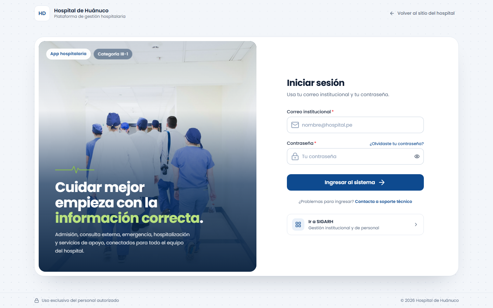

# 7. Referencias y contrarreferencias

Una **referencia** envía a un paciente a otro establecimiento para una atención que este hospital no puede dar; la **contrarreferencia** es la respuesta del establecimiento destino. Ruta: **Referencias › Referencias** (*Referencias y contrarreferencias de pacientes hacia otros establecimientos*).

Enviada›
Aceptada›
Contrarreferida

Una referencia **Enviada** puede quedar **Rechazada** por el destino; en ese caso no admite contrarreferencia.

## 7.1 Lista de referencias

<figure class="captura">

<figcaption>Figura 8. Referencias.</figcaption></figure>

- **Búsqueda:** *Buscar paciente / N.° referencia*, con el filtro **Estado** (Todos, Enviada, Aceptada, Rechazada, Contrarreferida).
- **Tabla:** N.°, Paciente, Origen, Destino, Estado y Fecha. **Ver referencia** abre el detalle y **Descargar PDF** baja el comprobante.
- **Exportar CSV** descarga el reporte de referencias. El reporte admite hasta **10 000 registros**: si hay más, el sistema indica *Acote los filtros*.

## 7.2 Generar una referencia desde Emergencia

Las referencias nacen de una **atención de Emergencia** cuyo destino fue *Referencia* (manual HIS-03) o de una **atención médica de Consulta Externa** con destino *Referencia* (manual HIS-02, capítulo 5). Pulse **Admitir desde Emergencia**: se abre *Admitir referencia derivada de Emergencia* con la lista de pacientes en espera. Si no hay nadie: *No hay pacientes de Emergencia esperando referencia.*

<ol class="pasos">
<li>Elija al paciente de la lista.</li>
<li>Elija el <strong>Tipo de destino</strong>: <strong>IPRESS externo</strong> u <strong>Hospital del sistema</strong>.</li>
<li>Si es externo, escriba el <strong>Establecimiento destino</strong> y, si lo conoce, su <strong>Código RENIPRESS</strong>. Si es del sistema, elija el <strong>Hospital destino</strong>.</li>
<li>Indique la <strong>Especialidad destino</strong> y el <strong>Diagnóstico</strong> (del catálogo CIE-10 del hospital).</li>
<li>Escriba el <strong>Motivo</strong> (obligatorio) y pulse <strong>Generar referencia</strong>.</li>
</ol>

| Regla | Mensaje |
|---|---|
| El destino de la atención no es una referencia. | *Este destino de emergencia no corresponde a referencia* |
| La atención ya generó una referencia. | *Esta atención de emergencia ya generó una referencia* |
| El destino ya se resolvió. | *Este destino ya fue resuelto* |
| Diagnóstico inactivo o inexistente. | *Seleccione un diagnóstico activo de este hospital* |
| Hospital de destino no válido. | *Hospital destino no válido* |

## 7.3 Registrar la respuesta del destino

Abra la referencia con **Ver referencia**. El detalle muestra el origen, el destino (con su tipo), la especialidad y el estado.

<ol class="pasos">
<li>En <strong>Resolución</strong> elija <strong>Aceptada por el destino</strong> o <strong>Rechazada</strong>.</li>
<li>Escriba una <strong>Observación</strong> y pulse <strong>Registrar resolución</strong>.</li>
</ol>

Solo se resuelve una referencia **recién enviada**: *Solo se puede aceptar o rechazar una referencia recién enviada*.

## 7.4 Registrar la contrarreferencia

Cuando el establecimiento destino responde con el resultado de su atención, regístrelo en la misma referencia:

| Campo | Obligatorio | Descripción |
|---|:-:|---|
| Fecha | Sí | Fecha de la contrarreferencia. |
| Profesional receptor | Sí | Quien atendió en el destino. |
| Diagnóstico | No | Diagnóstico del destino (CIE-10 activo). |
| Resumen | Sí | Resumen de la atención y de las indicaciones de seguimiento. |

Pulse **Registrar contrarreferencia**; la referencia pasa a **Contrarreferida**. No se puede registrar una contrarreferencia de una referencia rechazada o ya contrarreferida.
