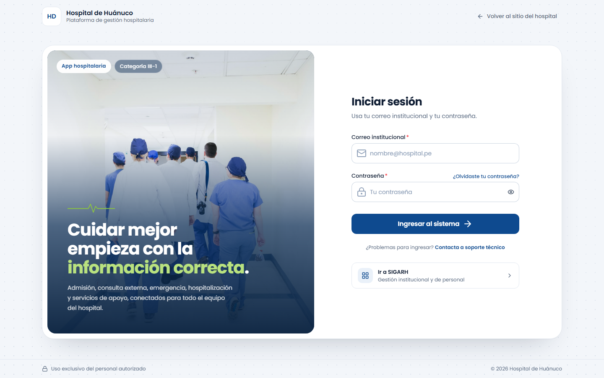

# 8. Servicio Social

Ruta: **Servicio Social › Servicio Social** (*Evaluaciones sociales, gestiones y seguimiento de casos*). Cada paciente evaluado tiene un **caso** con sus **gestiones**, que permanece **abierto** hasta que se cierra.

Evaluación (caso abierto)›
Gestiones›
Caso cerrado

## 8.1 Registrar una evaluación social

<figure class="captura">

<figcaption>Figura 9. Nueva evaluación social.</figcaption></figure>

Pulse **Nueva evaluación**.

| Campo | Obligatorio | Descripción |
|---|:-:|---|
| Código del paciente | Sí | Código largo de letras y números del paciente (ver el aviso de abajo). |
| Código del trabajador social | Sí | Código largo de letras y números del empleado. **Debe tener la profesión Trabajador Social (TSO)** en SIGARH. |
| Origen (opcional) | No | **Directo**, **Consulta Externa**, **Emergencia** u **Hospitalización**. Si elige uno, aparece el **código del origen**. |
| Tipo de vivienda | No | Propia, Alquilada, Alojada, Asentamiento humano o Sin vivienda. |
| Clasificación socioeconómica (referencial) | No | No pobre, Pobre o Pobre extremo. |
| Red de apoyo familiar | No | Descripción libre. |
| Factores de riesgo social | No | Marque los que apliquen: **Violencia familiar**, **Abandono**, **Situación de calle**, **Adulto mayor solo**, **Discapacidad sin soporte** y **Menor en riesgo**. |
| Requiere derivación externa | — | Si se marca, elija la **Entidad de derivación**: **MIMP**, **CEM**, **INABIF**, **DEMUNA** u **Otro**. |
| Recomendaciones | No | Indicaciones del trabajador social. |

!!! important "Importante"
    En esta versión la pantalla pide el **código del paciente** y el **código del trabajador social** (una cadena larga de letras y números) en lugar de un buscador. Para obtenerlos, abra la ficha del paciente (*Admisión › Pacientes › Ver ficha*) y la del empleado (*SIGARH › Recursos Humanos › Empleados*) y copie la parte final de la dirección que aparece en la barra del navegador. Si le resulta difícil, pida apoyo a soporte técnico.

Si el empleado no es trabajador social: *El profesional debe tener profesión Trabajador Social (TSO) registrada*. Si el paciente no existe: *Paciente no encontrado*.

## 8.2 Registrar gestiones y cerrar el caso

Los casos se listan con el filtro **Todos / Abierto / Cerrado**, con su estado, el trabajador social, la fecha, la clasificación y las gestiones ya registradas (Fecha, Tipo, Descripción y **Por** quién).

<ol class="pasos">
<li>En un caso <strong>abierto</strong>, elija el <strong>tipo de gestión</strong>: <strong>Visita domiciliaria</strong>, <strong>Llamada telefónica</strong>, <strong>Coordinación interinstitucional</strong>, <strong>Entrevista</strong>, <strong>Gestión de apoyo social</strong> u <strong>Otro</strong>.</li>
<li>Escriba la <strong>descripción de la gestión</strong> (sin ella, el botón queda deshabilitado) y pulse <strong>Registrar gestión</strong>.</li>
<li>Cuando el caso termine, pulse <strong>Cerrar caso</strong>. Aparece <em>Caso cerrado.</em></li>
</ol>

!!! note "Nota"
    Un caso cerrado no admite nuevas gestiones (*No se pueden registrar gestiones en un caso cerrado*) ni se puede cerrar otra vez (*Este caso ya está cerrado*). Si hace falta continuar, registre una nueva evaluación.
