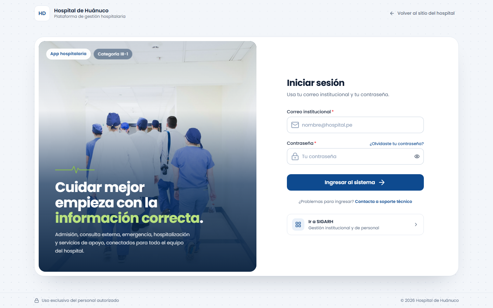

# 2. Confirmar citas

Una cita agendada en Admisión nace como **Separada**. Antes de la consulta, el personal de enfermería la **confirma**; solo una cita confirmada puede pasar a triaje y a la atención médica.

Separada›
Confirmada›
Triaje›
Atención médica›
Atendida

Ruta: **Consulta Externa › Citas por Confirmar** (*Confirmación de citas por enfermería*).

## 2.1 La lista de citas por confirmar

<figure class="captura">

<figcaption>Figura 1. Citas por confirmar.</figcaption></figure>

- **Indicadores:** Total pendientes, **Para hoy**, **Para mañana** y **Próximas (2+ días)**.
- **Filtro:** **Fecha** (vacía muestra *Todas las fechas*). **Refrescar** vuelve a cargar la lista.
- **Tabla:** Paciente, DNI, Fecha, Hora, Tipo de consulta y Especialidad.

## 2.2 Confirmar una cita

<ol class="pasos">
<li>Ubique la cita (puede filtrar por fecha).</li>
<li>Pulse <strong>Confirmar cita</strong> (el ícono de visto bueno de la fila).</li>
<li>La cita desaparece de la lista y aparece el aviso <em>Cita confirmada. Continúa en Registro de Triaje seleccionando la fecha de la cita.</em></li>
<li>Pulse <strong>Ir a Registro de Triaje</strong> para continuar.</li>
</ol>

Desde la misma fila puede **imprimir el comprobante** de la cita.

| Situación | Mensaje | Qué hacer |
|---|---|---|
| La cita ya no está separada | *No se puede confirmar una cita en estado '…'* | Revise su estado en Admisión › Citados (manual HIS-01). |
| Su programación se canceló o ya no está activa | *La programación ya no está activa; reprograme la cita.* | Reprograme la cita desde Admisión (HIS-01, capítulo 3). |
| La programación ya no tiene rol aprobado | *La programación requiere un rol aprobado vigente.* | Revise el rol en SIGARH (SIG-02). |

!!! important "Importante"
    **Confirme solo a los pacientes que ya llegaron o confirmaron su asistencia.** Una cita confirmada que no se atiende deja la programación con un cupo ocupado; si el paciente no se presenta, la cita debe cerrarse como **No asistió** (capítulo 4).
