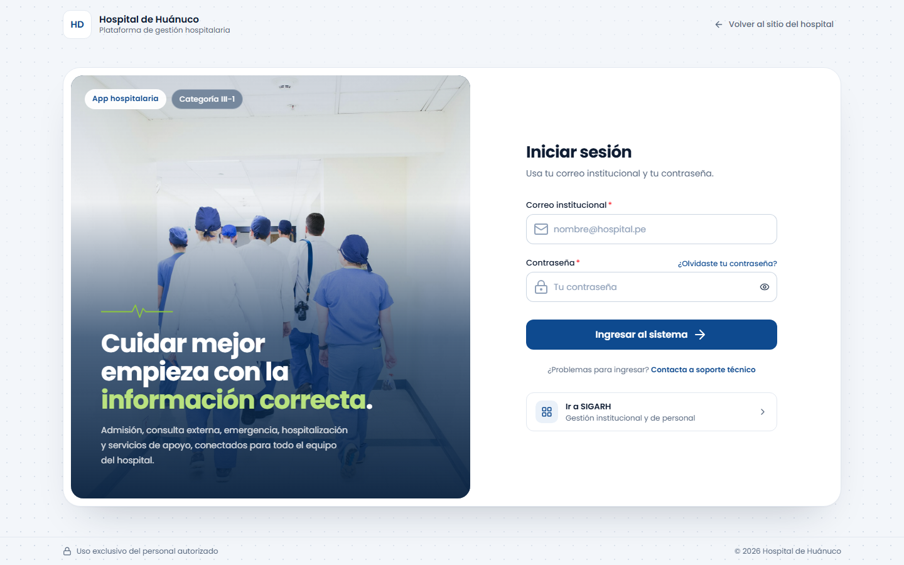

# 3. Triaje

El **triaje** registra los **signos vitales** del paciente antes de que el médico lo atienda. Es obligatorio: **el médico no puede iniciar la atención sin triaje**.

Ruta: **Consulta Externa › Registro de Triaje** (*Gestión de triaje de pacientes*).

## 3.1 El panel de triaje

<figure class="captura">

<figcaption>Figura 2. Panel de triaje.</figcaption></figure>

- **Filtros:** **Fecha**, **Especialidad** y **Servicio** (*Todas* / *Todos*).
- **Indicadores:** Total citas, Pendientes de triaje, Triaje completado y Especialidades.
- **Tabla:** HC (historia clínica), Paciente, Fuente de financiamiento, Especialidad / Servicio, Médico, Hora y **Pasó triaje** (*Pendiente* o *Completado*).
- **Acciones por cita:** **Registrar triaje** (si está pendiente) o **Ver triaje** (si ya se completó).

Solo aparecen las citas **confirmadas** de la fecha elegida. Si no hay ninguna: *No se encontraron citas para los filtros seleccionados*.

## 3.2 Registrar el triaje

<figure class="captura">

<figcaption>Figura 3. Registro de signos vitales.</figcaption></figure>

<ol class="pasos">
<li>En el panel, pulse <strong>Registrar triaje</strong> en la cita del paciente.</li>
<li>Complete los <strong>signos vitales</strong> (tabla siguiente). Cada campo muestra un rango de referencia como ejemplo.</li>
<li>Escriba <strong>peso y talla</strong>: el sistema calcula el <strong>IMC</strong> automáticamente y lo clasifica con una etiqueta.</li>
<li>Pulse el botón de guardar. El triaje queda en el historial del paciente.</li>
</ol>

| Campo | Obligatorio | Descripción |
|---|:-:|---|
| Pulso | Sí | Pulsaciones por minuto. |
| Frecuencia respiratoria | Sí | Respiraciones por minuto. |
| Temperatura (°C) | Sí | Mayor que cero. |
| Presión arterial | Sí | Dos casillas: **sistólica** y **diastólica**. |
| Frecuencia cardiaca | Sí | Latidos por minuto. |
| Peso (kg) y Talla (cm) | No | Con ambos, se calcula el **IMC**. |
| Perímetro cefálico (cm) | No | Útil en pediatría. |
| Perímetro abdominal (cm) | No | Opcional. |
| SO₂ (%) | No | Saturación de oxígeno: entre 0 y 100 %. |

Mensajes de validación: *Ingresa un número válido sin valores negativos*, *La medición debe ser mayor que cero* y *La saturación debe estar entre 0 y 100 %*.

| Regla del sistema | Mensaje |
|---|---|
| Solo se registra triaje en una cita **confirmada**. | *Solo se puede registrar triaje a una cita confirmada* |
| Una cita tiene **un solo triaje**. | *Esta cita ya tiene un triaje registrado* |

## 3.3 Corregir un triaje

Con **Ver triaje** se abre el registro, y desde allí se puede editar (*Revisa cuidadosamente los valores de los signos vitales. Los cambios en el triaje pueden afectar la prioridad de atención del paciente*). Los cambios quedan en el historial.

!!! important "Importante"
    **El triaje solo se puede corregir mientras la cita está confirmada, antes de la atención médica**: *Solo puede editar el triaje mientras la cita está confirmada, antes de la atención médica.* Una cita con triaje **ya no se puede reprogramar** (manual HIS-01).
