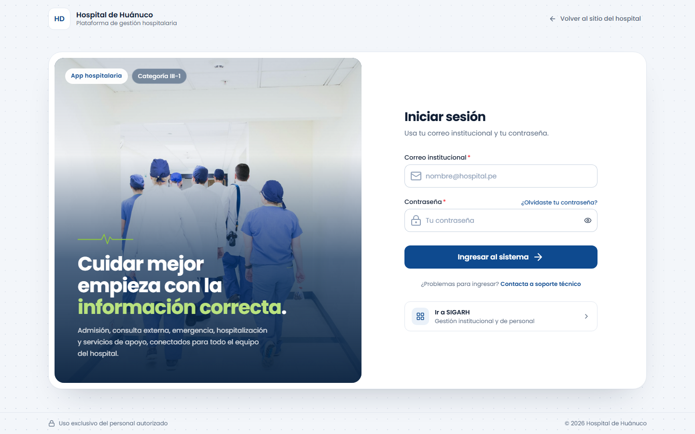
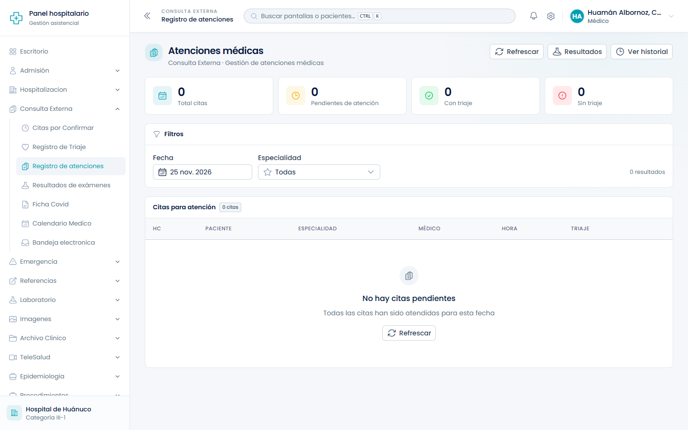

# 4. Atención médica

La **atención médica** es el registro clínico de la consulta: lo que refiere el paciente, lo que encuentra el médico, el diagnóstico, el tratamiento y las órdenes. Se cierra con la **firma electrónica** del médico y la cita pasa a **Atendida**.

!!! important "Importante"
    **Solo el médico programado puede registrar y cerrar la atención**, y debe tener su **cuenta vinculada a su ficha de empleado** (SIGARH › Mantenimiento › Usuarios) y su **colegiatura con habilitación registrada**. Antes de empezar, el médico necesita su **PIN de firma** (manual GEN-00, sección 4.5).

## 4.1 Antes de empezar

Cita confirmada›
Triaje registrado›
Atención médica›
Cierre con PIN

| Requisito | Si falta |
|---|---|
| La cita debe estar **confirmada**. | *La atención requiere una cita confirmada.* |
| La cita debe tener **triaje**. | *Registre el triaje antes de iniciar la atención médica.* |
| Una cita tiene **una sola** atención. | *Esta cita ya tiene atención médica.* |
| El usuario debe ser el médico programado, con cuenta vinculada, colegiatura y habilitación. | *La atención requiere una cuenta médica vinculada al empleado desde SIGARH › Mantenimiento › Usuarios.* / *Solo el médico programado con colegiatura y habilitación registrada puede modificar o cerrar la atención.* |

## 4.2 La lista de atenciones

Ruta: **Consulta Externa › Registro de Atenciones** (*Gestión de atenciones médicas*).

<figure class="captura">

<figcaption>Figura 4. Citas del día para atender.</figcaption></figure>

- **Filtros:** **Fecha** y **Especialidad**.
- **Indicadores:** Total citas, Pendientes de atención, **Con triaje** y **Sin triaje**.
- **Tabla:** HC, Paciente, Especialidad, Médico, Hora y Triaje. Abra la cita para atender al paciente.
- Si ya atendió a todos: *Todas las citas han sido atendidas para esta fecha*.

## 4.3 Los seis pasos de la atención

La pantalla de atención muestra el **nombre del paciente**, la especialidad, una barra de **Avance** y los pasos. **Guardar borrador** conserva lo escrito sin cerrar la atención.

<figure class="captura">

<figcaption>Figura 5. Pasos de la atención médica.</figcaption></figure>

1. Paciente y triaje›
2. Antecedentes›
3. Consulta›
4. Diagnóstico›
5. Plan y destino›
6. Órdenes y cierre

### Paso 1: Paciente y triaje

Muestra los datos del paciente y los **signos vitales** del triaje. Si no hay triaje: *No se registró triaje para esta cita.* (capítulo 3).

### Paso 2: Antecedentes

| Campo | Descripción |
|---|---|
| Alergias | **Importante.** Escriba *Ninguna conocida* si no tiene. |
| Patológicos | Enfermedades crónicas: HTA, diabetes, asma… |
| Quirúrgicos | Cirugías previas y año aproximado. |
| Familiares | Antecedentes familiares relevantes. |
| Obstétricos | Si aplica. Formato de ejemplo: *G:0 P:0-0-0-0*. |
| Otros | Hábitos, medicación habitual y demás información. |

!!! important "Importante"
    **Todos los antecedentes deben quedar documentados para cerrar la atención**: si no aplican o el paciente no refiere, **escríbalo expresamente** (*Documente los antecedentes; indique expresamente cuando no aplica o el paciente no refiere*).

### Paso 3: Consulta

| Campo | Para guardar el borrador | Para cerrar |
|---|:-:|:-:|
| **Motivo de consulta** (lo que refiere el paciente, con sus palabras) | Obligatorio | Obligatorio |
| **Enfermedad actual / Anamnesis** | Opcional | Obligatorio |
| **Examen clínico** (hallazgos por aparatos y sistemas) | Opcional | Obligatorio |

Si deja vacío el motivo: *El motivo de consulta es obligatorio*.

### Paso 4: Diagnóstico

<ol class="pasos">
<li>En <strong>Buscar en el catálogo CIE-10</strong> escriba al menos <strong>2 letras</strong> del código o de la descripción y elija de la lista.</li>
<li>Elija el tipo de cada diagnóstico: <strong>Presuntivo</strong>, <strong>Definitivo</strong> o <strong>Repetitivo</strong>.</li>
<li>Para retirar uno, use <strong>Quitar diagnóstico</strong>.</li>
</ol>

Reglas: se necesita **al menos un diagnóstico** para cerrar (*Registre al menos un diagnóstico CIE-10*), **no se repite el mismo diagnóstico** (*No repita un diagnóstico en la misma atención*) y solo valen diagnósticos **activos** del catálogo del hospital (*Seleccione diagnósticos activos del catálogo CIE-10 de este hospital*).

### Paso 5: Plan y destino

| Campo | Descripción |
|---|---|
| **Plan de tratamiento** | Tratamiento, manejo y controles indicados. Obligatorio para cerrar. |
| **¿A dónde va el paciente?** (obligatorio) | **Alta / Domicilio** (vuelve a casa con indicaciones), **Hospitalización** (se asigna cama al guardar) o **Referencia** (a otro establecimiento). |
| **Indicaciones de alta** | Solo con *Alta / Domicilio*: indicaciones, seguimiento y signos de alarma. Obligatorias para cerrar (*Registre las indicaciones de alta*). |
| **¿Necesita alguna orden?** | Marque **Receta de farmacia**, **Laboratorio**, **Imágenes** y/o **Interconsulta**. Al continuar se guarda la atención y se habilitan los formularios de cada orden. |
| **Observaciones** | Opcional. |

Pulse **Guardar y continuar**.

### Paso 6: Órdenes y cierre

Aquí se completan los documentos que marcó (capítulo 5), y se cierra la atención. Un aviso amarillo (*Hay cambios sin guardar en el destino o las órdenes*) indica que debe pulsar **Guardar ahora** antes de continuar.

## 4.4 Cerrar la atención

<ol class="pasos">
<li>Complete todos los documentos del paso 6.</li>
<li>Pulse <strong>Cerrar atención</strong>. Se abre <em>Confirmar firma</em>: <em>Ingresa tu PIN de firma electrónica para cerrar esta atención</em>.</li>
<li>Escriba su <strong>PIN (6 dígitos)</strong> y pulse <strong>Confirmar y cerrar</strong>.</li>
<li>Aparece <em>Atención cerrada correctamente. Ya no se puede editar.</em> La cita pasa a <strong>Atendida</strong>.</li>
<li>Pulse <strong>Descargar ficha PDF</strong> para obtener la <strong>Ficha de Atención</strong>, con la firma del médico.</li>
</ol>

Qué revisa el sistema al cerrar:

| Si falta… | Mensaje |
|---|---|
| Motivo, enfermedad actual, examen clínico o plan de tratamiento | *Complete los datos clínicos: …* |
| Antecedentes | *Documente los antecedentes; indique expresamente cuando no aplica o el paciente no refiere.* |
| Triaje | *La atención requiere triaje registrado.* |
| Diagnóstico | *Registre al menos un diagnóstico CIE-10.* |
| Destino | *Seleccione un destino del paciente válido.* |
| Indicaciones de alta (si el destino es Alta) | *Registre las indicaciones de alta.* |
| Algún documento marcado (receta, laboratorio, imágenes, interconsulta, hospitalización o referencia) | *Complete el documento de … antes del cierre.* |
| PIN de firma configurado | *Configura tu PIN de firma en Mi Perfil antes de continuar.* |
| PIN correcto | *Ingresa tu PIN de firma.* / *PIN incorrecto.* |

!!! important "Importante"
    **Una atención cerrada no se puede editar**: *No puede editar una atención cerrada* ni quitar un documento ya generado (*Ya existe un documento de …; no puede quitarlo de esta atención*). Revise todo antes de confirmar con el PIN.
