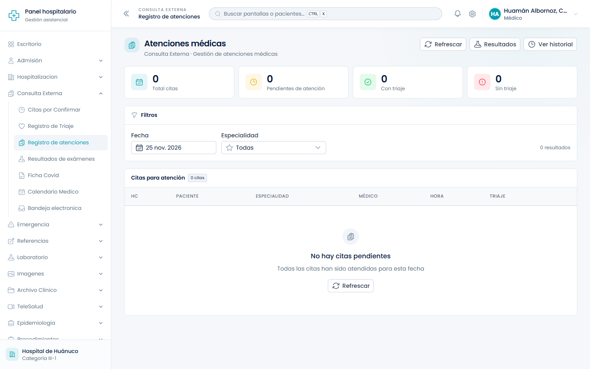

# 5. Órdenes y documentos de la atención

En el paso 5 de la atención se marcan las **órdenes** que necesita el paciente y su **destino**. En el paso 6 se completa un formulario por cada una. Todas siguen las mismas reglas:

- Antes de generar un documento hay que **guardar la atención** (*Guarda los cambios de la atención antes de generar órdenes*). Si no, el formulario indica *No hay un documento disponible*.
- Se genera **un solo documento de cada tipo** por atención: *Esta atención ya tiene una receta / orden de laboratorio / orden de imagen / interconsulta generada*.
- **Una atención cerrada solo permite consulta**: *La atención está cerrada; no puede generar documentos nuevos.*
- Los documentos marcados deben estar generados para poder cerrar (*Complete el documento de … antes del cierre*).

## 5.1 Receta de farmacia

La receta se dispensa después en Farmacia (manual HIS-08).

<figure class="captura">

<figcaption>Figura 6. Receta de farmacia en la atención.</figcaption></figure>

<ol class="pasos">
<li>En <strong>Buscar medicamento</strong> escriba al menos <strong>2 caracteres</strong> del código, el nombre o el DCI y elija de la lista.</li>
<li>Para cada medicamento complete la <strong>Cantidad</strong>, la <strong>Dosis</strong> (por ejemplo, <em>1 tableta</em>), la <strong>Frecuencia</strong> (<em>cada 8 horas</em>), la <strong>Duración (días)</strong> y las <strong>Indicaciones</strong>.</li>
<li>Para retirar un medicamento, pulse <strong>Quitar medicamento</strong>.</li>
<li>Pulse <strong>Generar Receta</strong>.</li>
</ol>

| Regla | Mensaje |
|---|---|
| Cada medicamento necesita dosis y frecuencia, **o** indicaciones completas. | *Completa Dosis y Frecuencia, o escribe Indicaciones completas.* |
| Solo medicamentos **activos** del hospital. | *Seleccione medicamentos activos de este hospital.* |

## 5.2 Laboratorio

<ol class="pasos">
<li>En <strong>Buscar examen</strong> escriba el código o el nombre y agregue los exámenes a la orden. Use <strong>Quitar examen</strong> para retirar uno.</li>
<li>Escriba la <strong>Indicación clínica</strong>: el motivo del estudio y la sospecha diagnóstica.</li>
<li>Pulse <strong>Generar Orden</strong>.</li>
</ol>

No se pueden repetir exámenes (*Seleccione exámenes sin duplicados*) ni usar exámenes que el hospital no tenga (*Examen no disponible en este hospital*). Los exámenes disponibles son los del catálogo de SIGARH (manual SIG-03, capítulo 6): solo los **activos** se pueden ordenar. Los resultados llegan al médico en **Resultados de exámenes** (capítulo 7).

## 5.3 Imágenes

Funciona igual que Laboratorio: **Buscar estudio**, **Indicación clínica** (*Motivo del estudio…*), **Quitar estudio** y **Generar Orden**. Sin duplicados (*Seleccione estudios de imagen sin duplicados*) y solo estudios del catálogo del hospital.

## 5.4 Interconsulta

Solicita la opinión de otra especialidad.

| Campo | Obligatorio | Descripción |
|---|:-:|---|
| Especialidad destino | Sí | Debe ser una especialidad activa: *Seleccione una especialidad activa de este hospital.* |
| Motivo | Sí | *Documente el motivo de la interconsulta.* |

Pulse **Generar Interconsulta**. Queda registrada en **Admisión para ser programada** y luego aparece como *confirmada y en proceso de atención*.

## 5.5 Destino: Hospitalización

Con el destino **Hospitalización**, el paso 6 muestra el formulario de ingreso:

| Campo | Obligatorio | Descripción |
|---|:-:|---|
| Cama disponible | Sí | Solo camas libres. *Debes seleccionar una cama.* |
| Especialidad de ingreso | No | La especialidad que solicita la hospitalización. |
| Diagnóstico de ingreso (CIE-10) | No | Búsqueda por código o descripción. |

Pulse **Registrar Ingreso**. El paciente pasa al módulo de Hospitalización (manual HIS-04).

| Regla | Mensaje |
|---|---|
| El destino de la atención debe ser Hospitalización. | *El destino de la atención debe ser HOSPITALIZACION* |
| Una atención tiene una sola hospitalización. | *Esta atención ya tiene una hospitalización registrada* |
| No se usan camas de unidades especializadas. | *La cama … pertenece a una unidad especializada (UCI, quirófano o recuperación)* |

!!! note "Nota"
    **El alta de hospitalización no se registra desde la consulta**: se hace firmando la epicrisis en el expediente de hospitalización (*El alta se registra firmando la epicrisis en el expediente de hospitalización*). Vea el manual HIS-04.

## 5.6 Destino: Referencia

Con el destino **Referencia**, elija el tipo de destino con los botones **Hospital de nuestro sistema** o **IPRESS externo**:

| Campo | Obligatorio | Descripción |
|---|:-:|---|
| Hospital destino | Sí (hospital del sistema) | Hospital al que se envía. |
| Nombre del IPRESS | Sí (externo) | Establecimiento externo. |
| Código RENIPRESS | No | Ej.: *00004319*. |
| Especialidad destino | No | Ej.: *Cardiología*. |
| Motivo | Sí | Motivo de la referencia. |

Pulse **Generar Referencia**. Queda *pendiente de aprobación* y luego se sigue en **Referencias** (manual HIS-01, capítulo 7).
