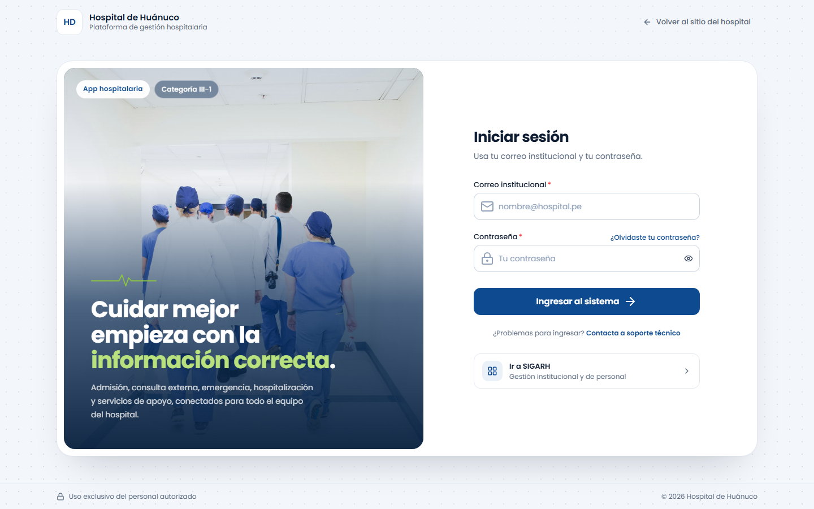

# 6. Historial de atenciones y resultados

## 6.1 Historial de atenciones

Ruta: **Consulta Externa › Registro de Atenciones**, botón **Ver historial** (*Historial de atenciones médicas*). Reúne las atenciones ya registradas, con su estado de cierre.

- **Filtros:** **Fecha** (*Todas las fechas*), **DNI paciente** (*Buscar por DNI…*) y **Especialidad**. **Limpiar filtros** los quita.
- **Indicadores:** Total atenciones, **Firmadas**, **Pendientes** (en borrador) y Especialidades.
- **Tabla:** Fecha / Hora, Paciente, DNI, Especialidad, Médico, **Destino** (Alta, Hospitalización o Referencia) y **Estado**.
- **Ver / Editar atención** abre la atención: se puede **continuar un borrador**, pero una atención **firmada** se abre solo para consulta (capítulo 4).

Si no hay coincidencias: *No se encontraron atenciones para los filtros seleccionados*.

## 6.2 Resultados de exámenes

Ruta: **Consulta Externa › Resultados de Exámenes** (*Laboratorio e imágenes validados de lo que solicitaste*). Cada médico ve aquí **solo los exámenes que él mismo solicitó**, cuando Laboratorio o Imágenes los **validan**.

<figure class="captura">

<figcaption>Figura 7. Resultados de exámenes validados.</figcaption></figure>

<ol class="pasos">
<li>Filtre por tipo: <strong>Todos</strong>, <strong>Laboratorio</strong> o <strong>Imágenes</strong>, o busque por <em>Paciente, DNI o N.° de orden</em>.</li>
<li>La tabla muestra Validado (fecha), Paciente, Tipo, Exámenes y Orden.</li>
<li>Pulse <strong>Ver resultado</strong> para abrir el informe, o <strong>Todos los resultados del paciente</strong> para ver su historial completo de exámenes.</li>
</ol>

Mientras no haya resultados validados: *Aquí aparecen los exámenes que solicitaste cuando Laboratorio o Imágenes los validan.* Si un examen no aparece, aún no fue validado; su seguimiento está en el manual HIS-07.
