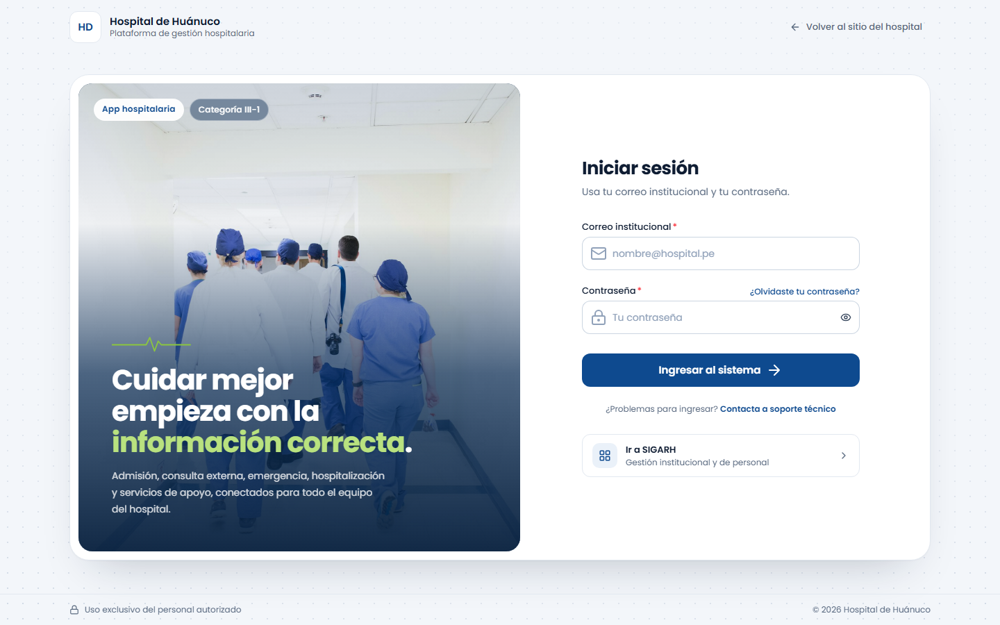

# 7. Bandeja electrónica y calendario médico

## 7.1 Bandeja electrónica

Ruta: **Consulta Externa › Bandeja Electrónica** (*Tareas pendientes del médico*). Es el resumen de lo que el médico tiene por hacer; se actualiza con **Actualizar**.

<figure class="captura">

<figcaption>Figura 8. Bandeja electrónica del médico.</figcaption></figure>

Tiene tres listas:

| Lista | Qué muestra | Si está vacía |
|---|---|---|
| **Atenciones pendientes de firmar** | Borradores de atención sin cerrar. | *No tienes atenciones pendientes de firmar.* |
| **Citas para hoy** | Citas del día que le corresponden. | *No tienes citas pendientes para hoy.* |
| **Interconsultas** | Interconsultas dirigidas a su especialidad. | *No hay interconsultas pendientes para tu especialidad.* |

!!! important "Importante"
    **La bandeja depende de que la cuenta esté vinculada a un empleado médico.** Si no lo está, aparece *Esta bandeja depende de tu vínculo como médico (empleado). Tu cuenta no tiene un empleado asociado, así que no hay tareas que mostrarte aquí.* El vínculo se hace en SIGARH › Mantenimiento › Usuarios (manual SIG-04, sección 5.3).

## 7.2 Calendario médico

Ruta: **Consulta Externa › Calendario Médico**. Muestra las programaciones médicas como un calendario.

- **Vistas:** **Mes**, **Semana**, **Día** y **Lista**. **Anterior**, **Hoy** y **Siguiente** navegan por el tiempo.
- **Filtros:** **Servicio** (*Todos*) y **Especialidad** (*Todas*).
- Al elegir una programación se abre su detalle (fecha, médico y horario). **Ir a Agendamiento** lleva a la pantalla de citas (manual HIS-01, capítulo 3).
- Si no hay nada: *No hay programaciones en este período con estos filtros.*

## 7.3 Ficha COVID

La opción **Ficha Covid** del menú de Consulta Externa abre la misma ficha que usa el módulo de Laboratorio; se describe en el manual **HIS-07**.
