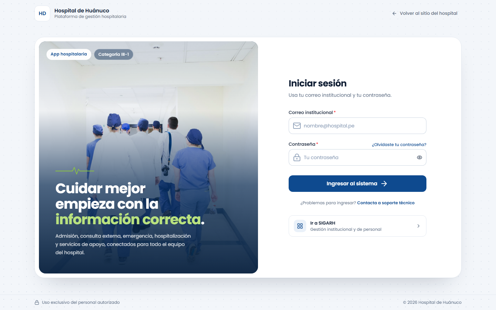

# 9. Procedimientos

Los **procedimientos** son actos clínicos programables (por ejemplo, una ecografía o una curación) que se realizan con **consentimiento informado**. Su duración y código vienen del catálogo *Tiempos de procedimientos* (manual SIG-03, capítulo 7).

## 9.1 Asignaciones

Ruta: **Procedimientos › Asignaciones** (*Habilita al personal responsable para cada procedimiento*). Solo quien está **habilitado** puede realizar un procedimiento.

<ol class="pasos">
<li>En <strong>Procedimiento</strong> elija el procedimiento del catálogo.</li>
<li>En <strong>Empleado</strong> elija al profesional.</li>
<li>Pulse <strong>Asignar</strong>.</li>
</ol>

La tabla muestra Procedimiento, Empleado y la acción **Desasignar**. Si ya está habilitado: *Este empleado ya está habilitado para este procedimiento*.

## 9.2 Atenciones de procedimientos

Ruta: **Procedimientos › Atenciones** (*Programa, documenta y completa procedimientos con consentimiento informado*).

<figure class="captura">

<figcaption>Figura 9. Atenciones de procedimientos.</figcaption></figure>

Programar›
Consentimiento›
Realizar

<ol class="pasos">
<li>Pulse <strong>Programar</strong> y elija el <strong>Paciente</strong>, el <strong>Procedimiento</strong>, el <strong>Profesional ejecutor</strong> (obligatorios) y la <strong>Fecha y hora</strong>.</li>
<li>Antes de realizarlo, registre el <strong>Consentimiento</strong> informado del paciente.</li>
<li>Cuando se realice, pulse <strong>Realizar</strong>. Para anular, use <strong>Cancelar</strong>.</li>
</ol>

La tabla muestra Número, Paciente, Procedimiento, Ejecutor, Fecha y Estado.

| Regla | Mensaje |
|---|---|
| El profesional debe estar **habilitado** para ese procedimiento. | *El empleado no está habilitado para realizar este procedimiento* |
| **No se puede realizar sin consentimiento informado.** | *No se puede realizar el procedimiento sin consentimiento informado (Ley N.° 26842, art. 4)* |
| Solo se actúa sobre una atención en el estado correspondiente. | *La atención está en estado '…'* |

!!! important "Importante"
    El **consentimiento informado** es obligatorio por ley antes de cualquier procedimiento. El sistema no permite pulsar **Realizar** hasta que esté registrado.
