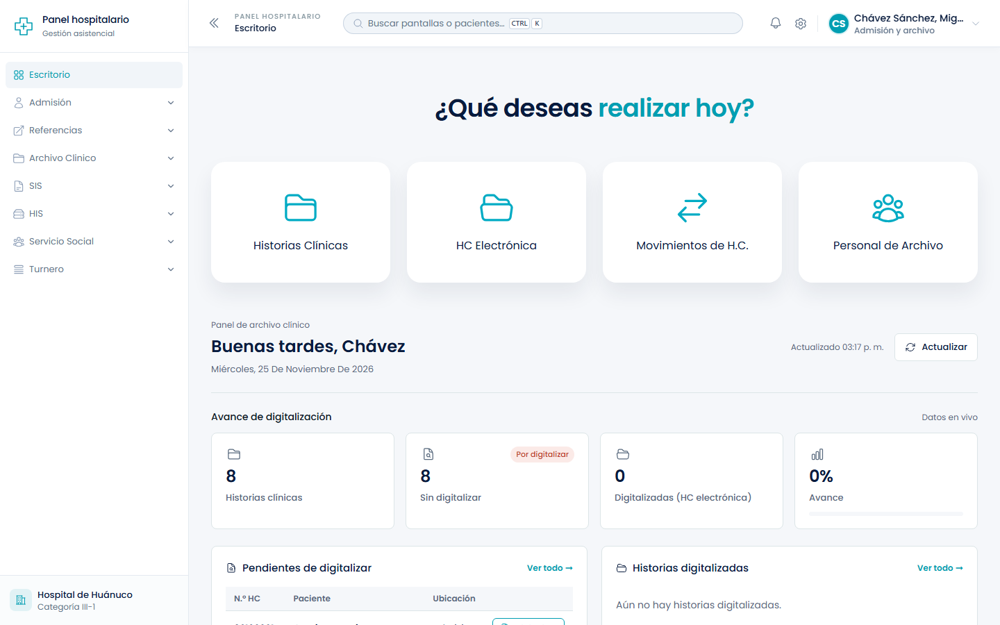

# 2. Admisión de emergencia

Ruta: **Emergencia › Admisión de emergencia** (*Gestión de admisiones de emergencia*). Es una **admisión directa**: se registra sin cita ni programación médica.

## 2.1 La lista de admisiones

<figure class="captura">

<figcaption>Figura 1. Admisiones de emergencia.</figcaption></figure>

- **Indicadores y pestañas:** Total Admisiones, **Admitidos**, **En Triaje** y **Atendidos**, con la pestaña **Todos**.
- **Búsqueda:** *Buscar por paciente o cuenta…*
- **Tabla:** Cuenta, HC, Paciente, Servicio, Triaje, Estado y Acción. Si no hay ninguna: *Comienza registrando una nueva admisión de emergencia*.

## 2.2 Registrar una admisión

Pulse **Nueva Admisión** (*Ingresa los datos de la admisión de emergencia*).

<ol class="pasos">
<li>Escriba el <strong>DNI del paciente</strong> (8 dígitos) y pulse <strong>Buscar</strong> (o <kbd>Enter</kbd>). Si el DNI no es válido: <em>Ingresa un DNI válido de 8 dígitos</em>.</li>
<li>Si el paciente <strong>no está registrado</strong>, complete su registro rápido y guárdelo. Si falta algún dato: <em>Completa todos los campos requeridos del paciente</em>.</li>
<li>Complete los datos de la admisión (tabla siguiente).</li>
<li>Pulse el botón para registrar. El sistema <strong>crea el triaje automáticamente</strong> y lo lleva a la pantalla de triaje (capítulo 3).</li>
</ol>

!!! tip "Consejo"
    Si el paciente llega **sin identificar**, registre primero su ficha como paciente no identificado (NN) en Admisión (manual HIS-01, capítulo 2) y complete sus datos cuando se conozcan.

| Campo | Obligatorio | Descripción |
|---|:-:|---|
| Primer nombre, Apellido paterno, Fecha de nacimiento y Sexo | Sí | Solo si el paciente es nuevo. Apellido materno es opcional. Sexo: **Masculino** o **Femenino**. |
| Servicio de emergencia | Sí | **Emergencia General**, **Gineco-Obstetricia**, **Pediatría** o **Traumatología**. |
| Fuente de financiamiento | No | Por defecto *Sin seguro / el del paciente*. **Se necesita para emitir órdenes urgentes** (capítulo 4). |
| Hora de llegada | Sí | No puede ser futura: *La hora de llegada no puede ser futura*. |
| Medio de llegada | No | **Por sus propios medios**, **Ambulancia**, **Policía**, **Bomberos** u **Otro**. |
| Procedencia | No | **Domicilio**, **Vía pública**, **Centro laboral**, **Referido de otro establecimiento** u **Otro**. |
| Tópico | No | **Medicina**, **Pediatría**, **Gineco-Obstetricia**, **Cirugía / Trauma** o **Shock trauma**. Por defecto *Asignar después del triaje*. |
| Acompañante | No | Nombre y apellidos, documento, parentesco, teléfono y dirección. Todos opcionales. |

| Mensaje | Qué hacer |
|---|---|
| *Selecciona un paciente primero* | Busque o registre al paciente antes de registrar la admisión. |
| *El paciente no pertenece a este hospital* | Revise el paciente elegido. |
