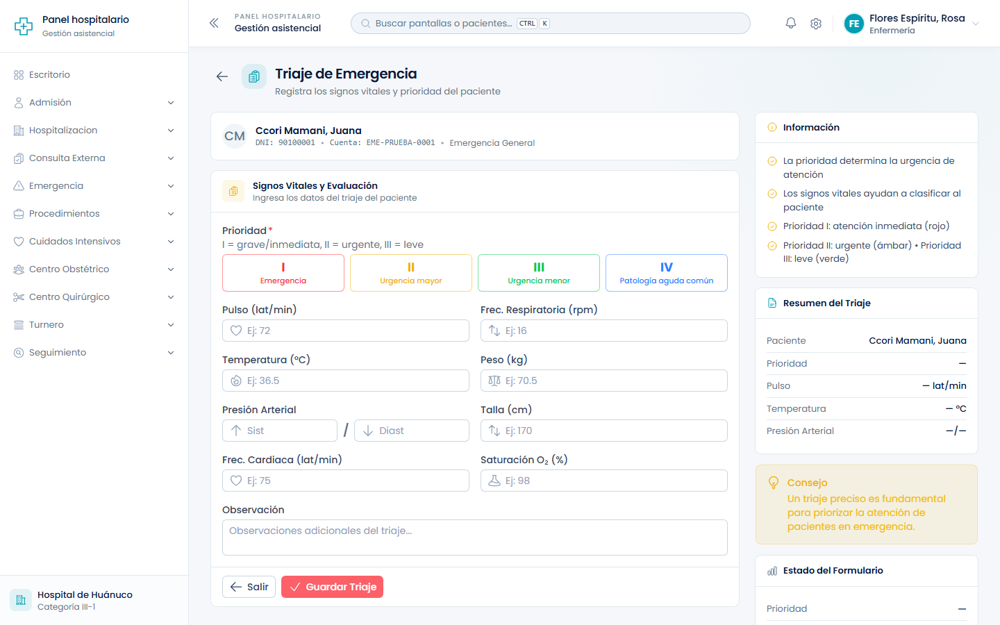

# 3. Triaje de emergencia

Ruta: la pantalla se abre sola tras registrar la admisión, y también desde la fila de la lista con **Registrar triaje** (*Registra los signos vitales y prioridad del paciente*). El triaje **ordena la atención**: determina quién se atiende primero.

<figure class="captura">

<figcaption>Figura 2. Triaje de emergencia.</figcaption></figure>

## 3.1 La prioridad

Es **obligatoria** (*Selecciona una prioridad*). Elija una de las cuatro tarjetas:

| Prioridad | Significado | Color |
|:-:|---|---|
| **I** | Emergencia | Rojo |
| **II** | Urgencia mayor | Amarillo |
| **III** | Urgencia menor | Verde |
| **IV** | Patología aguda común | Azul |

## 3.2 Signos vitales

Complete los que pueda medir; sirven para clasificar al paciente.

| Campo | Descripción |
|---|---|
| Pulso (lat/min) | Pulsaciones por minuto. |
| Frec. respiratoria (rpm) | Respiraciones por minuto. |
| Temperatura (°C) | Ej.: 36.5. |
| Presión arterial | Dos casillas: **Sist** y **Diast**. |
| Frec. cardiaca (lat/min) | Latidos por minuto. |
| Saturación O2 (%) | Saturación de oxígeno. |
| Peso (kg) y Talla (cm) | Opcionales. |
| Observación | Nota libre. |

Pulse guardar. Una admisión tiene **un solo triaje**: *Esta admisión ya tiene un triaje registrado*.

!!! important "Importante"
    **Un triaje preciso es fundamental**: de él depende el orden de atención. Revise la prioridad antes de guardar. El paciente pasa a **En triaje** y queda listo para el médico.
