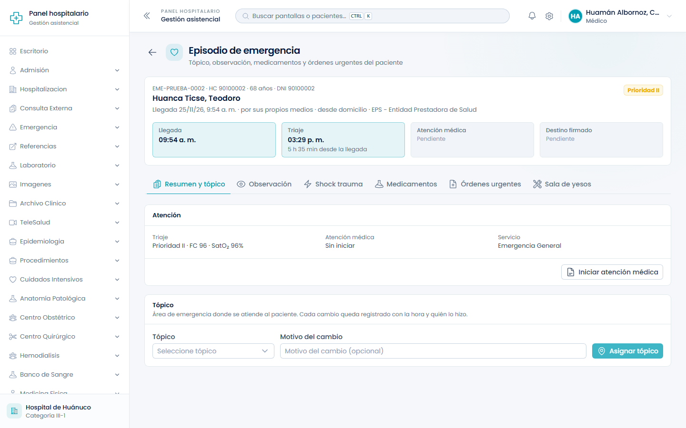

# 4. Episodio de emergencia

El **episodio** reúne todo lo que ocurre con el paciente mientras está en Emergencia: tópico, observación, medicamentos y órdenes urgentes (*Tópico, observación, medicamentos y órdenes urgentes del paciente*). Se abre desde la admisión del paciente.

<figure class="captura">

<figcaption>Figura 3. Episodio de emergencia.</figcaption></figure>

En la cabecera hay accesos a **Registrar triaje** (si falta) y a **Iniciar atención médica** o **Ver atención médica** (capítulo 5). El episodio tiene estas secciones: **Resumen**, **Observación**, **Shock trauma**, **Yesos**, **Medicamentos** y **Órdenes**.

!!! important "Importante"
    **Las indicaciones, las reevaluaciones y las órdenes las registra el médico**, con una cuenta vinculada a su ficha de empleado (*La cuenta debe estar vinculada a un empleado*). Si el episodio ya se cerró: *El episodio de emergencia ya está cerrado*.

## 4.1 Asignar el tópico

Pulse **Asignar tópico** (o **Cambiar tópico**), elija el **Tópico** —**Medicina**, **Pediatría**, **Gineco-Obstetricia**, **Cirugía / Trauma** o **Shock trauma**— y, si cambia, escriba el **Motivo del cambio** (opcional). No se puede elegir el mismo: *El paciente ya está en el tópico de …*.

## 4.2 Observación

Algunos pacientes permanecen en **observación** antes de decidir su destino. Solo es posible **después del triaje** (*El paciente pasa a observación después del triaje*).

<ol class="pasos">
<li>En <strong>Ingreso a observación</strong>, elija la <strong>Cama o sillón</strong>, la <strong>Hora de ingreso</strong> y el <strong>Motivo</strong> (obligatorio). Pulse <strong>Ingresar a observación</strong>.</li>
<li>Durante la estancia, registre cada control en <strong>Nueva reevaluación</strong>: <strong>Hora</strong>, signos (PA, FC, FR, T°, SatO2, Glasgow) y la <strong>Evolución</strong> (obligatoria). Elija la <strong>Decisión</strong>: <em>Continúa en observación</em>, <em>Alta</em>, <em>Hospitalización</em>, <em>Referencia</em>, <em>Centro Quirúrgico</em> o <em>UCI</em>. Pulse <strong>Registrar reevaluación</strong>.</li>
<li>Al salir, en <strong>Egreso de observación</strong> indique la <strong>Fecha y hora</strong>, el <strong>Destino</strong> y el <strong>Resumen</strong> (obligatorio), y pulse <strong>Registrar egreso</strong>.</li>
</ol>

Las observaciones previas del paciente se listan en **Observaciones anteriores**, con Ingreso, Egreso, Horas, Destino y Reevaluaciones.

| Regla | Mensaje |
|---|---|
| La cama debe ser de una sala activa **tipo Observación**. | *La cama o sillón debe pertenecer a una sala activa tipo OBSERVACION (SIGARH › Infraestructura Hospitalaria)* |
| La cama debe estar libre. | *La cama … está ocupada* |
| Un paciente ocupa una sola cama. | *El paciente ya está en observación* |
| Las horas deben ser reales. | *… no puede ser futura* / *… no puede ser anterior al ingreso del paciente* |
| Solo se egresa una vez. | *El paciente ya egresó de observación* |

Si no hay camas libres, el formulario lo avisa: *No hay camas libres. Las camas de observación se configuran en SIGARH › Infraestructura hospitalaria, en salas de tipo Observación.* (manual SIG-03).

## 4.3 Medicamentos

En **Indicaciones médicas** se registran los medicamentos indicados, y en **Administraciones**, cada vez que se aplican.

<ol class="pasos">
<li>En <strong>Nueva indicación</strong>, elija el <strong>Medicamento (catálogo)</strong> o escriba el nombre en <strong>O describa el medicamento</strong>.</li>
<li>Complete la <strong>Dosis</strong> (por ejemplo, <em>100 mg</em>), la <strong>Vía</strong> (<em>EV, IM, VO…</em>) —obligatorias— y, si desea, la <strong>Frecuencia</strong> y la <strong>Indicación</strong>. Pulse <strong>Indicar</strong>.</li>
<li>Para cada aplicación, pulse <strong>Administrar</strong> en la indicación y registre la <strong>Hora</strong>.</li>
<li>Para retirar una indicación, pulse <strong>Suspender</strong>.</li>
</ol>

| Regla | Mensaje |
|---|---|
| El medicamento debe estar activo en el catálogo. | *Medicamento no encontrado o inactivo* |
| Una indicación suspendida no admite cambios. | *La indicación ya está suspendida* / *La indicación está suspendida* |

**Excepción protocolizada:** si es necesario administrar un medicamento **sin indicación previa**, use **Registrar administración sin indicación (excepción protocolizada)**: complete medicamento, **Dosis**, **Vía**, **Hora** y la **Justificación (protocolo aplicado)** —obligatoria— y pulse **Registrar excepción**.

## 4.4 Órdenes urgentes de laboratorio e imágenes

En **Órdenes de laboratorio e imágenes**, pulse **Nueva orden urgente**: elija el **Servicio de apoyo** (**Laboratorio** o **Imágenes**), el **Servicio solicitante** (obligatorio), agregue los exámenes con **Agregar examen** (use **Quitar** para retirar uno), escriba la **Indicación clínica** y pulse **Emitir orden urgente**. La lista muestra N.°, Servicio de apoyo, Exámenes, Prioridad, Origen y fecha de emisión.

!!! important "Importante"
    Antes de emitir una orden, la admisión debe tener **fuente de financiamiento**: *Registre la fuente de financiamiento de la admisión antes de emitir órdenes*. Se registra al admitir al paciente (capítulo 2).

## 4.5 Shock trauma y yesos

- **Shock trauma:** registro de intervenciones en pacientes críticos, con la **Intervención**, el **Diagnóstico CIE-10** (obligatorio, *Diagnóstico CIE-10 no encontrado* si no existe) y el **Material** (obligatorio).
- **Yesos:** registro de procedimientos de inmovilización: **Procedimiento** (por ejemplo, venda de yeso o algodón laminado), **Diagnóstico CIE-10** y **Material**.
