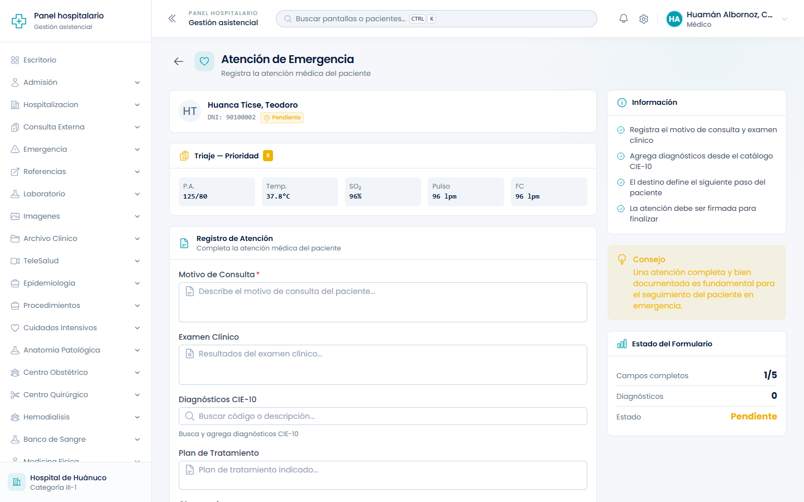

# 5. Atención de emergencia

La **atención** es el registro clínico del médico, con su **destino** y su **firma**. Ruta: **Emergencia › Atenciones** (*Seguimiento desde la admisión hasta el destino clínico*) o **Iniciar atención médica** desde el episodio.

## 5.1 La lista de atenciones

Filtre por **Todos los destinos** o busque por *Paciente o número de cuenta*. La tabla muestra Cuenta, Paciente, **Prioridad**, Motivo, **Destino**, **Firma**, **Derivación** y la acción para abrirla.

## 5.2 Registrar la atención

<figure class="captura">

<figcaption>Figura 4. Atención de emergencia.</figcaption></figure>

La pantalla (*Registra la atención médica del paciente*) muestra arriba los signos vitales del triaje (P.A., Temp., SO2, Pulso, FC).

| Campo | Obligatorio | Descripción |
|---|:-:|---|
| Motivo de consulta | Sí | *El motivo de consulta es requerido* (también al firmar). |
| Examen clínico | No | Hallazgos del examen. |
| Diagnósticos CIE-10 | No | Búsqueda por código o descripción (*Buscar código o descripción…*). |
| Plan de tratamiento | No | Tratamiento indicado. |
| Observaciones | No | Notas adicionales. |
| **Destino** | Sí | Define el siguiente paso del paciente (ver 5.3). |

Una admisión tiene **una sola atención**: *Esta admisión ya tiene una atención registrada*. Los diagnósticos deben ser del catálogo del hospital: *Uno o más diagnósticos no pertenecen a este hospital*.

## 5.3 El destino

| Destino | Qué ocurre |
|---|---|
| **Atención ambulatoria** | El paciente se atiende como consulta y se va. |
| **Alta** | Egresa con indicaciones. |
| **Fallecido** | Registra la defunción. |
| **Hospitalización** | Pasa a la cola de hospitalización (capítulo 6). |
| **UCI / cuidados críticos**, **Centro quirúrgico**, **Centro obstétrico** | Pasan a la cola del servicio. |
| **Referencia** | Se genera una referencia a otro establecimiento (manual HIS-01, capítulo 7). |
| **Interconsulta** | Se solicita evaluación a otra especialidad. |

Cuando el destino es **Hospitalización, Interconsulta, Referencia, UCI, Centro quirúrgico o Centro obstétrico**, la atención de emergencia **se cierra cuando ese servicio registra el ingreso** del paciente. Si el destino ya se completó: *El destino ya fue completado*.

## 5.4 Firmar la atención

<ol class="pasos">
<li>Revise todo: <em>La atención debe ser firmada para finalizar</em>.</li>
<li>Pulse firmar. Se abre la ventana: <em>Ingresa tu PIN de firma electrónica para cerrar esta atención</em>.</li>
<li>Escriba su <strong>PIN (6 dígitos)</strong> y confirme.</li>
</ol>

| Regla | Mensaje |
|---|---|
| La cuenta debe estar vinculada a un empleado médico. | *La atención requiere una cuenta médica vinculada al empleado desde SIGARH › Mantenimiento › Usuarios.* |
| Solo firma un médico con colegiatura habilitada. | *Solo un médico con colegiatura y habilitación registrada puede firmar la atención.* |
| Falta configurar el PIN. | *Configura tu PIN de firma en Mi Perfil antes de continuar.* |
| PIN vacío o equivocado. | *Ingresa tu PIN de firma.* / *PIN incorrecto.* |
| La atención ya se firmó (la **Ficha de Atención** se emite solo después de firmar). | *Esta atención ya está firmada* / *No se puede editar una atención ya firmada* |
