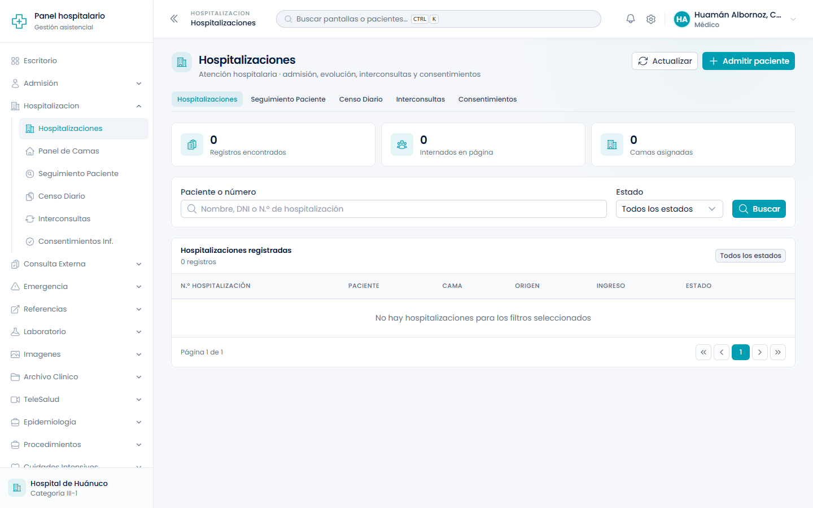

# 2. Hospitalizaciones

Ruta: **Hospitalización › Hospitalizaciones** (*Atención hospitalaria: admisión, evolución, interconsultas y consentimientos*). Es la lista de pacientes internados y el punto de partida de su atención.

## 2.1 La lista

<figure class="captura">

<figcaption>Figura 1. Hospitalizaciones registradas.</figcaption></figure>

- **Indicadores:** Registros encontrados, **Internados** (en la página) y **Camas asignadas**.
- **Filtros:** **Estado** (*Todos los estados*, *Internados*, *Con alta*) y la búsqueda *Nombre, DNI o N.º de hospitalización*, con **Buscar** y **Limpiar filtros**.
- **Tabla:** N.º de hospitalización, Paciente, Cama, **Origen**, Ingreso y Estado.

Para cada paciente, **Ver detalle** abre un panel con sus **Notas de evolución**, **Interconsultas** y **Consentimientos informados**, y **Abrir expediente** lleva al expediente completo (capítulo 4).

## 2.2 Admitir a un paciente derivado

Los pacientes llegan a hospitalización con un destino ya decidido.

### Desde Emergencia

Pulse **Admitir paciente** (*Admitir paciente derivado de Emergencia*), elija la atención de la lista (`cuenta · paciente · DNI`) y complete:

| Campo | Obligatorio | Descripción |
|---|:-:|---|
| Cama disponible | Sí | Solo camas libres de hospitalización. |
| Especialidad de ingreso | No | Especialidad que solicita la hospitalización. |
| Diagnóstico de ingreso (CIE-10) | No | Búsqueda por código o descripción. |

Pulse **Admitir**. Si el paciente ya fue admitido: *Esta atención de emergencia ya generó una hospitalización*.

### Desde Consulta Externa

El ingreso se registra en la atención médica (manual HIS-02, sección 5.5), y el paciente aparece en la lista.

| Regla | Mensaje |
|---|---|
| El destino debe ser hospitalización. | *Este destino de emergencia no corresponde a hospitalización* |
| El destino no se resuelve dos veces. | *Este destino ya fue resuelto* |
| La cama debe ser de hospitalización. | *La cama … pertenece a una unidad especializada (UCI, quirófano o recuperación)* |
| La cama debe estar libre. | *La cama … no está disponible (estado actual: …)* |
| Diagnóstico y especialidad activos. | *Seleccione un diagnóstico activo de este hospital* / *Seleccione una especialidad activa de este hospital* |

## 2.3 Notas de evolución

En **Ver detalle**, pulse **Agregar nota**.

| Campo | Obligatorio | Descripción |
|---|:-:|---|
| Tipo | Sí | **Médica** o **Enfermería**. |
| Pulso, Temperatura °C, Sat. O2 % | No | Signos del momento. |
| Evolución | Sí | Estado del paciente. |
| Plan / indicaciones | No | Conducta a seguir. |

!!! important "Importante"
    **Cada persona registra solo su tipo de nota**: la cuenta de enfermería solo escribe notas de **Enfermería** y las notas **médicas** las registra el médico. Con un paciente de alta no se agregan notas: *No se pueden agregar notas a una hospitalización con alta*.

## 2.4 Dar de alta

**No existe un botón de alta en esta lista.** Si lo intenta, el sistema responde *El alta se registra firmando la epicrisis en el expediente de hospitalización*. Vea el capítulo 4.
