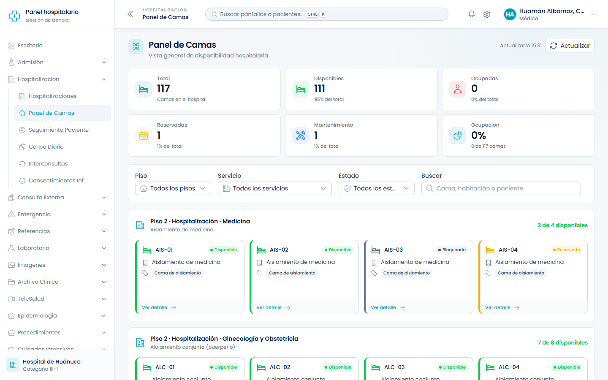

# 3. Panel de camas

Ruta: **Hospitalización › Panel de Camas** (*Vista general de disponibilidad hospitalaria*). Muestra todas las camas con su estado, para decidir dónde ubicar a un paciente.

<figure class="captura">

<figcaption>Figura 2. Panel de camas.</figcaption></figure>

- **Indicadores:** Total, **Disponibles**, **Ocupadas**, **Reservadas**, **Mantenimiento** y **% de Ocupación**.
- **Filtros:** **Piso** (*Todos los pisos*), **Servicio** (*Todos los servicios*), **Estado** (*Todos los estados*) y **Buscar** por *Cama, habitación o paciente*. **Limpiar filtros** los quita. Si no hay resultados: *Prueba cambiando o limpiando los filtros seleccionados.*
- Al elegir una cama se abre el **Detalle operativo de la cama**.

Las camas, salas y pisos se definen en SIGARH (manual SIG-03, capítulo 3). Un cambio de estado de una cama con paciente se hace desde el expediente, con un traslado o el alta (capítulo 4).

!!! tip "Consejo"
    Revise el panel antes de admitir a un paciente: la ocupación de cada servicio le muestra dónde hay camas libres y evita el error *La cama … no está disponible*.
