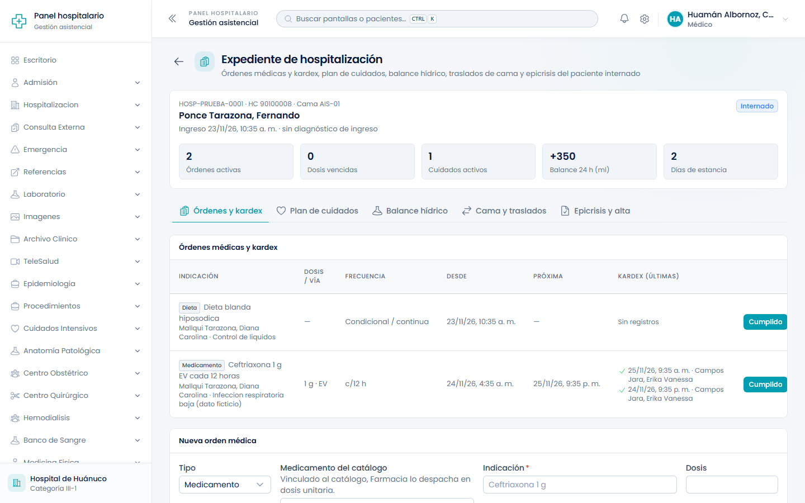

# 4. Expediente de hospitalización

El **expediente** reúne la historia del paciente internado: sus órdenes, el kardex, el plan de cuidados, el balance hídrico, los traslados de cama y la epicrisis con el alta (*Órdenes médicas y kardex, plan de cuidados, balance hídrico, traslados de cama y epicrisis del paciente internado*). Se abre con **Abrir expediente** desde la lista de hospitalizaciones.

<figure class="captura">

<figcaption>Figura 3. Expediente de hospitalización.</figcaption></figure>

En la parte superior se ven los indicadores **Órdenes activas**, **Dosis vencidas**, **Cuidados activos**, **Balance 24 h (ml)** y **Días de estancia**. Las secciones son **Órdenes**, **Cuidados**, **Balance**, **Cama** y **Epicrisis**.

!!! important "Importante"
    **Las órdenes médicas y la epicrisis las registra el médico** (*Las indicaciones médicas y la epicrisis las registra el médico*), con la cuenta vinculada a su ficha (*La cuenta debe estar vinculada a un empleado para registrar en el expediente*). Con el paciente ya dado de alta, nada se modifica: *La hospitalización ya tiene alta*. Las horas no pueden ser futuras ni anteriores al ingreso.

## 4.1 Órdenes médicas y kardex

En **Nueva orden médica**:

| Campo | Obligatorio | Descripción |
|---|:-:|---|
| Tipo | Sí | **Medicamento**, **Dieta**, **Cuidado**, **Procedimiento** u **Otro**. |
| Medicamento del catálogo | Solo medicamentos | Vinculado al catálogo: **Farmacia lo despacha en dosis unitaria** (manual HIS-08). |
| Indicación | Sí | Qué se ordena. |
| Dosis y Vía | Medicamentos | *Una orden de medicamento requiere dosis y vía*. |
| Cada (horas) | No | Frecuencia; calcula la próxima toma. |
| Indicaciones adicionales | No | Notas. |

Pulse **Agregar orden**. La tabla muestra Indicación, Dosis / vía, Frecuencia, **Desde** y **Próxima**, y el **kardex** (últimos registros). Para cada toma, enfermería elige:

- **Cumplido:** se administró.
- **Omitido:** no se administró; se pide el motivo (*Indique el motivo de la omisión*).
- **Suspender:** retira la orden.

Una orden suspendida no admite más cambios (*La orden ya está suspendida*), y un medicamento debe estar activo en el catálogo (*Medicamento no encontrado o inactivo*).

## 4.2 Plan de cuidados de enfermería

En **Nuevo plan de cuidados**, enfermería escribe el **Diagnóstico de enfermería**, el **Objetivo** y las **Intervenciones** (los tres obligatorios) y pulsa **Agregar plan**. Cada plan admite **Registrar evaluación** y se cierra con **Marcar resuelto**. Un plan resuelto ya no se modifica: *El plan ya está resuelto*.

## 4.3 Balance hídrico

Registre cada ingreso y egreso de líquidos: **Hora**, **Tipo** (**Ingreso** o **Egreso**), **Concepto** (por ejemplo, soluciones EV, vía oral, diuresis) y **Volumen (ml)**, y pulse **Registrar**. La tabla muestra, por día, los **Ingresos**, los **Egresos** y el **Neto**; el indicador *Balance 24 h* resume las últimas 24 horas.

## 4.4 Traslado de cama

En **Cama**, elija la **Cama destino** y escriba el **Motivo** (ambos obligatorios) y pulse **Trasladar**. El historial muestra Fecha, **Desde**, **Hacia**, Motivo y quién lo registró.

| Regla | Mensaje |
|---|---|
| La cama destino debe ser otra. | *La cama destino es la misma que la actual* |
| Debe ser de hospitalización y estar libre. | *La cama … pertenece a una unidad especializada* / *La cama … está …* |

## 4.5 Epicrisis y alta

La **epicrisis** es el resumen del internamiento. **Al firmarla se registra el alta**: la hospitalización se cierra, las órdenes activas se suspenden y la cama queda **en limpieza**.

<ol class="pasos">
<li>En <strong>Epicrisis y alta</strong>, agregue los <strong>Diagnósticos de egreso (CIE-10)</strong>, marcando uno como <strong>Principal</strong> y los demás como <strong>Secundario</strong>.</li>
<li>Complete el <strong>Resumen de la evolución</strong>, los <strong>Procedimientos realizados</strong> y el <strong>Tratamiento recibido</strong>.</li>
<li>Elija el <strong>Tipo de alta</strong> (<em>Alta médica</em>, <em>Alta voluntaria</em>, <em>Transferencia</em>, <em>Fuga</em> o <em>Fallecimiento</em>) y la <strong>Condición de egreso</strong> (<em>Curado</em>, <em>Mejorado</em>, <em>Igual</em>, <em>Empeorado</em> o <em>Fallecido</em>).</li>
<li>Escriba el <strong>Pronóstico</strong>, las <strong>Indicaciones de alta</strong> y el <strong>Control ambulatorio</strong>.</li>
<li>Pulse <strong>Guardar borrador</strong> para conservar lo escrito, o <strong>Firmar y dar de alta</strong> e ingrese su <strong>PIN</strong>.</li>
</ol>

Para firmar son obligatorios: el **diagnóstico principal**, el **resumen de la evolución**, el **tratamiento recibido**, el **tipo de alta**, la **condición de egreso** y las **indicaciones de alta** (estas últimas no hacen falta si el paciente falleció). Si falta algo, el sistema lo lista: *Complete antes de firmar: …*. Tras la firma, **Epicrisis PDF** descarga el documento.

| Regla | Mensaje |
|---|---|
| Un solo diagnóstico principal. | *Solo puede haber un diagnóstico principal de egreso* |
| El fallecimiento debe ser coherente. | *Alta por fallecimiento y condición fallecido deben coincidir* |
| Primero se registra la epicrisis. | *Registre primero la epicrisis* |
| Solo firma un médico habilitado, con su PIN. | *La epicrisis y el alta las firma un médico con colegiatura y habilitación registradas* / *Configura tu PIN de firma en Mi Perfil antes de continuar* / *PIN incorrecto* |
| No se vuelve a firmar. | *La epicrisis ya está firmada* |
