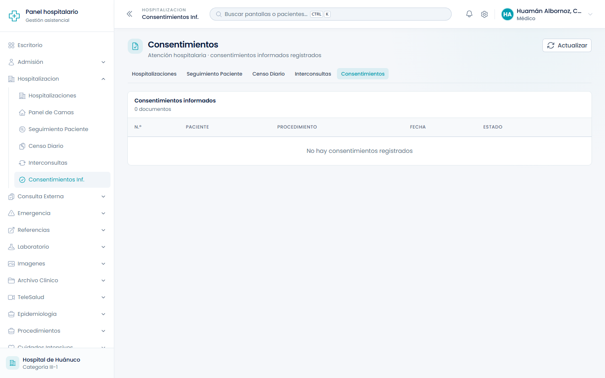

# 5. Seguimiento, censo, consentimientos e interconsultas

Cuatro pantallas del menú de **Hospitalización** comparten el mismo diseño: filtros, indicadores y una tabla.

## 5.1 Seguimiento del paciente

Ruta: **Hospitalización › Seguimiento Paciente** (*Pacientes internados y su evolución*). Es la **única opción que ve el personal de enfermería**. Muestra a los pacientes internados con su cama, su diagnóstico y los **días de internamiento**, y desde allí se abren las notas de evolución y el expediente (capítulos 2 y 4).

## 5.2 Censo diario

Ruta: **Hospitalización › Censo Diario** (*Ocupación de camas, ingresos y altas del día*). Elija la **Fecha del censo**: el sistema muestra las **camas de hospitalización**, el **% de ocupación**, los **ingresos del día** y las **altas del día**. Use **Exportar PDF** o **Exportar CSV** para obtener el censo.

## 5.3 Consentimientos informados

Ruta: **Hospitalización › Consentimientos Inf.** (*Consentimientos informados registrados*).

<figure class="captura">

<figcaption>Figura 4. Consentimientos informados.</figcaption></figure>

Pulse **Registrar consentimiento**:

| Campo | Obligatorio | Descripción |
|---|:-:|---|
| Procedimiento | Sí | El procedimiento que se informa. |
| Fecha | Sí | Fecha del consentimiento. |
| Riesgos y beneficios explicados | Sí | Resumen de lo que se explicó al paciente. |
| Firmante | Sí | **Paciente** o **Representante**. |
| Documento del firmante | Sí | DNI u otro documento. |
| Relación | Si firma un representante | Parentesco o relación con el paciente. |
| Testigo | No | Opcional. |

Cada consentimiento ofrece **Comprobante PDF**. Si el paciente retira su consentimiento, pulse **Revocar consentimiento** y escriba el **Motivo de revocación** (obligatorio).

## 5.4 Interconsultas de hospitalización

Ruta: **Hospitalización › Interconsultas** (*Interconsultas de hospitalización y emergencia*). Muestra las solicitudes: N.°, Especialidad, Motivo, **Urgente**, Estado y Fecha.

- **Solicitar una interconsulta** a un paciente internado: en el **detalle** de la hospitalización pulse **Solicitar interconsulta** y complete **Especialidad** y **Motivo** (obligatorios), y marque **Urgente** si corresponde.
- **Admitir una interconsulta de Emergencia:** pulse **Admitir interconsulta** y elija la solicitud de la lista (manual HIS-03, capítulo 6).
