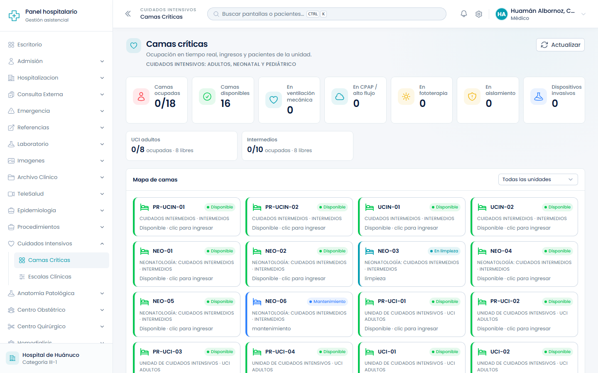

# 6. Cuidados intensivos

Las **unidades críticas** son cuatro: **UCI** (adultos), **Intermedios**, **UCI neonatal** y **UCI pediátrica**. Sus camas se crean en SIGARH, en salas del tipo correspondiente (manual SIG-03, capítulo 3). Si aún no existen, la pantalla indica *No hay camas críticas* y recuerda crearlas en *SIGARH › Infraestructura Hospitalaria*.

## 6.1 Camas críticas

Ruta: **Cuidados Intensivos › Camas Críticas** (*Ocupación en tiempo real, ingresos y pacientes de la unidad*).

<figure class="captura">

<figcaption>Figura 5. Camas críticas.</figcaption></figure>

- **Indicadores:** Camas ocupadas, Camas disponibles, **En ventilación mecánica**, **En CPAP / alto flujo**, **En fototerapia**, **En aislamiento** y **Dispositivos invasivos**.
- **Mapa de camas:** cada cama con su estado, filtrable por **Todas las unidades**.
- **Pacientes:** pestañas **En la unidad**, **Egresados** y **Todos**; la tabla muestra Ingreso, Paciente, Unidad / cama, Diagnóstico, Origen, Estancia y Estado. **Abrir** entra al detalle del ingreso (6.4).

## 6.2 Ingresar a un paciente

Elija una **cama libre** en el mapa: se abre *Ingreso a la cama …*.

| Campo | Obligatorio | Descripción |
|---|:-:|---|
| Origen | Sí | **Recién nacido de Centro Obstétrico** u **Otro paciente (nacido fuera o reingreso)**. |
| Recién nacido / Paciente | Sí | Búsqueda por *código de pulsera o apellidos* (recién nacido) o por *DNI o apellidos* (otro paciente). |
| Fecha y hora de ingreso | No | No puede ser futura. |
| Diagnóstico (CIE-10) | Sí | Diagnóstico de ingreso. |
| Médico responsable | Sí | Médico a cargo. |
| Motivo de ingreso | Sí | Por qué ingresa. |
| Aislamiento | No | **Ninguno**, **Contacto**, **Gotas** o **Aéreo**. |
| Peso (kg) | No | Peso del paciente. |

En la **UCI neonatal** se piden además los datos del nacimiento (los toma del parto si viene de Centro Obstétrico): **Nacimiento**, **Edad gestacional**, **Peso al nacer (g)**, **Apgar** al minuto 1 y 5, **Vía de nacimiento** (*Vaginal* o *Cesárea*), **Procedencia** (*Intrahospitalario* o *Extrahospitalario*), **Talla al nacer**, **Perímetro cefálico** y **Madre**.

| Regla | Mensaje |
|---|---|
| La cama debe ser de una sala del tipo de la unidad. | *La cama debe pertenecer a una sala activa tipo … (SIGARH › Infraestructura Hospitalaria)* |
| La cama debe estar libre. | *La cama … está …* |
| Un paciente está en una sola unidad. | *El paciente ya está en la unidad (…)* |
| Si está hospitalizado, esa es su hospitalización de origen. | *El paciente está …; esa es la hospitalización de origen.* |
| La UCI neonatal recibe hasta los 28 días; la pediátrica, menores de 18 años. | *Paciente neonato (28 días o menos): ingréselo a la UCI neonatal* / *La UCI pediátrica recibe menores de 18 años; use la UCI de adultos* |
| La UCI neonatal exige datos del nacimiento. | *La UCI neonatal requiere los datos del nacimiento (edad gestacional y peso al nacer)* |
| El ingreso no puede preceder al nacimiento. | *El ingreso no puede ser anterior al nacimiento* |

## 6.3 Escalas clínicas

Ruta: **Cuidados Intensivos › Escalas Clínicas** (*Catálogo de escalas usadas en la unidad; cambiar el rango crea una nueva versión*). La tabla muestra **Código**, **Nombre**, **Mínimo**, **Máximo** y **Versión**.

<ol class="pasos">
<li>Pulse <strong>Agregar</strong> y escriba el <strong>Código</strong>, el <strong>Nombre de la escala</strong> y el rango <strong>Mín.</strong> y <strong>Máx.</strong></li>
<li>Pulse <strong>Guardar</strong>. Con <strong>Desactivar</strong> / <strong>Activar</strong> decide si se ofrece al registrar un puntaje.</li>
</ol>

!!! note "Nota"
    Si cambia el rango de una escala, el sistema crea una **nueva versión**: los puntajes ya registrados conservan la versión con la que se midieron.

## 6.4 Detalle del ingreso: registros de la unidad

Al abrir un paciente, se registran los controles por secciones. **Todas las horas deben estar entre el ingreso a la unidad y el momento actual**: *La hora no puede ser futura* / *La hora no puede ser anterior al ingreso a la unidad*. Tras el egreso no se agregan registros (*El paciente ya egresó de la unidad*).

| Sección | Qué se registra |
|---|---|
| **Monitoreo hemodinámico** | **Hora**, PA, PAM, FC, FR, SpO2, T°, PVC, glucosa y observación. |
| **Soporte respiratorio** | Soporte (oxigenoterapia, CPAP, alto flujo o ventilación) y **evento** (*Inicio*, *Ajuste* o *Retiro*), con FiO2, flujo, presión, PEEP, volumen tidal, FR programada, presión de soporte y presión pico. |
| **Infusiones continuas** | **Fármaco**, evento (*Inicio*, *Cambio* o *Suspensión*), dosis, unidad y velocidad (ml/h). |
| **Dispositivos invasivos** | Dispositivo, sitio e instalación; **Retirar** cuando se retira (el sistema cuenta los días). |
| **Balance** | Ingresos y egresos de líquidos, con el balance de 24 horas y el acumulado, el peso actual y la diuresis. |
| **Soporte nutricional** | Tipo (*Enteral* o *Parenteral*), **fórmula**, vía, volumen y kcal por día; **Iniciar** y **Finalizar**. |
| **Escalas clínicas** | **Escala** y **puntaje** del catálogo (6.3), con detalle opcional. |
| **Egreso de la unidad** | Destino, condición, fecha y hora, y **Resumen de la estancia** (obligatorio); **Registrar egreso**. |
| **Neonatal** | **Solo en la UCI neonatal** (en otra unidad el sistema responde *… se registra solo en UCI neonatal*): antropometría (peso, talla, perímetro cefálico), **termorregulación**, **fototerapia** (con bilirrubina total) y **surfactante** (producto, dosis en mg/kg y técnica: *INSURE*, *LISA / MIST* o *Por tubo (TET)*). |

| Regla | Mensaje |
|---|---|
| Un soporte o infusión activo no se inicia otra vez. | *Ese soporte ya está activo; registre un ajuste o el retiro* / *Esa infusión ya está activa; registre un cambio o la suspensión* |
| Para ajustar o retirar debe haber iniciado. | *Ese soporte no está activo; registre primero el inicio* / *Esa infusión no está activa* |
| Una sola nutrición del mismo tipo a la vez. | *Ya hay una nutrición de ese tipo en curso; finalícela antes de iniciar otra* |
