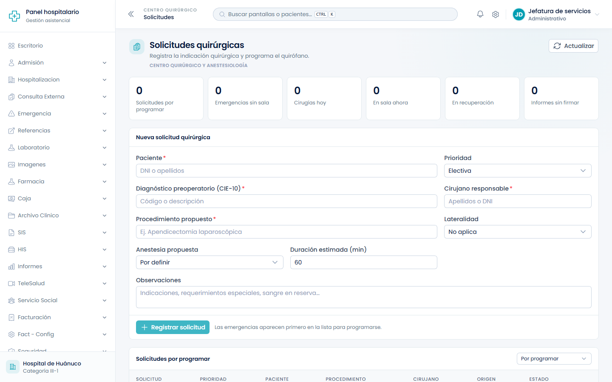

# 2. Centro Quirúrgico: solicitudes, programación y recuperación

Una cirugía sigue este camino:

Solicitud›
Programación de sala›
Acto quirúrgico (capítulo 3)›
Recuperación

## 2.1 Solicitudes

Ruta: **Centro Quirúrgico › Solicitudes**. Muestra las solicitudes de cirugía y las de emergencia sin sala.

<figure class="captura">

<figcaption>Figura 1. Solicitudes quirúrgicas.</figcaption></figure>

- **Indicadores:** Solicitudes por programar, **Emergencias sin sala**, Cirugías hoy, En sala ahora, En recuperación e Informes sin firmar.
- **Pestañas:** **Por programar**, **Programadas**, **Realizadas**, **Canceladas** y **Todas**.
- **Tabla:** Solicitud, Prioridad, Paciente, Procedimiento, Cirujano, **Origen** y Estado.

### Registrar una solicitud

Pulse **Registrar solicitud** (*Registra la indicación quirúrgica y programa el quirófano*).

| Campo | Obligatorio | Descripción |
|---|:-:|---|
| Paciente | Sí | O el origen clínico (hospitalización, emergencia…). Se indica uno solo de los dos. |
| Prioridad | No | **Electiva**, **Urgencia** o **Emergencia**. |
| Diagnóstico preoperatorio (CIE-10) | Sí | Búsqueda por código o descripción. |
| Cirujano responsable | Sí | El que operará y firmará el informe. |
| Procedimiento propuesto | Sí | Nombre de la cirugía. |
| Lateralidad | No | **No aplica**, **Derecha**, **Izquierda** o **Bilateral**. |
| Anestesia propuesta | No | Tipo previsto. |
| Duración estimada (min) | No | Para reservar el horario. |
| Observaciones | No | Notas. |

Si no se indica el origen clínico ni el paciente: *Indique un origen clínico o el paciente*; si se indican ambos: *Indique como máximo un origen clínico*.

## 2.2 Programación de sala

Ruta: **Centro Quirúrgico › Programación de Sala** (*Programación de sala de operaciones*). Se navega por días con **Día anterior** y **Día siguiente**, y se filtra por **Todos los quirófanos**.

<ol class="pasos">
<li>En <strong>Solicitudes por programar</strong>, pulse <strong>Programar</strong> en la solicitud.</li>
<li>Elija el <strong>Quirófano</strong>, la hora de <strong>Inicio</strong> y de <strong>Fin</strong> (obligatorios).</li>
<li>Asigne el equipo: <strong>Anestesiólogo</strong>, <strong>Ayudante</strong>, <strong>Instrumentista</strong> y <strong>Circulante</strong>.</li>
<li>Pulse <strong>Confirmar programación</strong>.</li>
</ol>

| Regla | Mensaje |
|---|---|
| Debe haber quirófanos creados. | *No hay quirófanos: créelos en SIGARH › Infraestructura Hospitalaria (tipo Quirófano).* |
| La sala debe ser un quirófano activo. | *La sala debe ser un quirófano activo (SIGARH › Infraestructura Hospitalaria)* |
| El fin debe ser posterior al inicio. | *La hora de fin debe ser posterior a la de inicio* |
| Una persona no ocupa dos funciones. | *Una misma persona no puede ocupar dos funciones en el equipo quirúrgico* |
| El quirófano no puede tener dos cirugías a la vez. | *El quirófano … ya tiene una cirugía en ese horario* |
| El personal no puede estar en dos cirugías a la vez. | *El … ya está asignado a la cirugía … en ese horario* |
| No se programa en el pasado. | *No se puede programar en una hora pasada* |
| La solicitud debe estar pendiente. | *La solicitud está …; no se puede programar* |

Para **cancelar** una solicitud ya programada, primero hay que suspender la cirugía: *Solo se cancela una solicitud sin cirugía activa; suspenda primero la programación*.

## 2.3 Recuperación

Ruta: **Centro Quirúrgico › Recuperación** (*Pacientes en recuperación postanestésica*). Muestra a los pacientes que salieron de sala: Paciente, Procedimiento, **Salió de sala**, **Ingreso a URPA** y **Último Aldrete**. Con **Abrir** entra a la cirugía para registrar sus controles (capítulo 3, sección 3.5).

## 2.4 Lista de verificación (configuración)

Ruta: **Centro Quirúrgico › Lista de Verificación**. Es el catálogo de ítems de la **lista de verificación de seguridad de la cirugía** (basada en la OMS), organizados en tres fases: **Entrada**, **Pausa** y **Salida**. La tabla muestra **Orden**, **Ítem** y **Estado**; con **Agregar** se crea un ítem, con **Guardar** se confirma, y **Desactivar** / **Activar** decide si se pide en cada cirugía.
