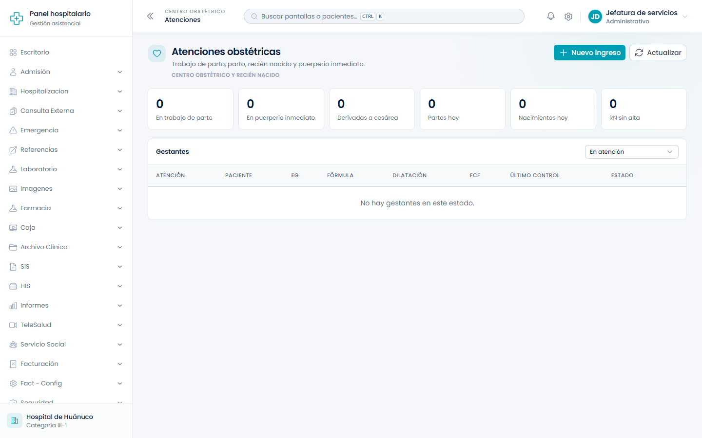

# 4. Centro Obstétrico

Atiende a la gestante desde su ingreso hasta el alta, pasando por el trabajo de parto, el parto, el recién nacido y el puerperio inmediato.

Ingreso›
Trabajo de parto (partograma)›
Parto o cesárea›
Puerperio›
Alta

## 4.1 Ingreso obstétrico

Ruta: **Centro Obstétrico › Nuevo Ingreso** (*Evaluación de ingreso de la gestante al centro obstétrico*).

| Bloque | Campos |
|---|---|
| **Paciente y motivo** | **Gestante** (obligatoria; debe ser de sexo femenino), fecha y hora de ingreso, **Diagnóstico de ingreso (CIE-10)**, **Obstetra / médico responsable** y **Motivo de ingreso** (obligatorios). |
| **Antecedentes obstétricos** | **Gestas** (obligatorio), partos a término, pretérmino, abortos, hijos vivos, controles prenatales, FUR, edad gestacional en semanas y días, **Riesgo obstétrico** (*Bajo* o *Alto*). |
| **Examen de ingreso** | PA, pulso, temperatura, altura uterina, FCF, **Presentación** (*Cefálica*, *Podálica* o *Transversa*), dilatación, borramiento, dinámica uterina, **Membranas** (*Íntegras* o *Rotas*), hora de rotura y líquido amniótico. |

Pulse **Registrar ingreso**. Mensajes: *La atención obstétrica corresponde a una paciente de sexo femenino* y *La paciente ya tiene la atención … abierta*.

## 4.2 Lista de atenciones

Ruta: **Centro Obstétrico › Atenciones** (*Trabajo de parto, parto, recién nacido y puerperio inmediato*).

<figure class="captura">

<figcaption>Figura 3. Atenciones obstétricas.</figcaption></figure>

- **Indicadores:** En trabajo de parto, En puerperio inmediato, Derivadas a cesárea, **Partos hoy**, **Nacimientos hoy** y **RN sin alta**.
- **Pestañas:** **En atención**, **Trabajo de parto**, **Puerperio**, **Derivadas a cesárea**, **Con alta** y **Todas**.
- **Tabla:** Atención, Paciente, EG, Fórmula, Dilatación, FCF, Último control y Estado. **Abrir** entra a la atención.

## 4.3 Partograma y trabajo de parto

En **Controles del trabajo de parto**, pulse **Registrar control**:

| Campo | Obligatorio | Descripción |
|---|:-:|---|
| Hora | No | Hora del control. |
| Dilatación (cm) | Sí | Dilatación cervical. |
| FCF | Sí | Frecuencia cardiaca fetal. |
| Borramiento, plano (de -3 a +3), contracciones cada 10 minutos y su duración | No | Evolución del trabajo de parto. |
| PA, pulso, temperatura, oxitocina (mUI/min), membranas y líquido | No | Controles maternos. |
| Responsable | Sí | Quien realiza el control. |

El sistema muestra **Alertas clínicas** según los valores. Un control no puede ser anterior al último registrado (*El control no puede ser anterior al último registrado*).

## 4.4 Parto y recién nacido

### Parto vaginal

Con **Registrar parto vaginal**: **Fecha y hora del parto** y **Atendido por** (obligatorios), **Tipo** (*Eutócico* o *Distócico*), posición, **Desgarro (grado)**, **Alumbramiento** (*Dirigido* o *Espontáneo*), hora, sangrado y complicaciones.

### Cesárea

Si la vía es la cesárea, pulse **Derivar a cesárea** y complete la **Prioridad** (*Emergencia*, *Urgencia* o *Electiva*), el **Gineco-obstetra**, la **Indicación** y el **Diagnóstico (CIE-10)**. *El nacimiento se produce por cesárea en Centro Quirúrgico*: allí se programa y se realiza (capítulos 2 y 3).

### Recién nacido

Con **Registrar recién nacido**: **Fecha y hora de nacimiento**, **Peso (g)** y **Atendido por** (obligatorios), **Sexo** (*Femenino*, *Masculino* o *Indeterminado*), **Condición** (*Vivo* o *Nacido muerto*), talla, perímetro cefálico, **Apgar** al minuto 1 y al 5, edad gestacional por examen, detalle de la reanimación y malformaciones. **Dar alta del RN** cierra su atención (*El recién nacido ya tiene alta del centro obstétrico*). Si requiere cuidados críticos, ingresa a la UCI neonatal (manual HIS-04, capítulo 6).

## 4.5 Puerperio y alta

En **Puerperio inmediato**, registre los controles: hora, PA, pulso, temperatura, **Útero** (*Contraído* o *Blando*), **Sangrado** (*Escaso*, *Moderado* o *Abundante*) y **Responsable** (obligatorio). Luego, con **Dar alta materna**, indique el **Destino**, la **Condición** y las **Indicaciones** (obligatorias).

| Regla | Mensaje |
|---|---|
| Se necesita el parto o la derivación a cesárea. | *Registre primero el parto o la derivación a cesárea* |
| Si fue cesárea, debe haberse iniciado. | *La cesárea aún no se ha iniciado en Centro Quirúrgico* |
| Antes del alta, controles de puerperio. | *Registre los controles del puerperio inmediato antes del alta* |
| El alta se da una sola vez. | *La atención ya tiene alta materna* |
