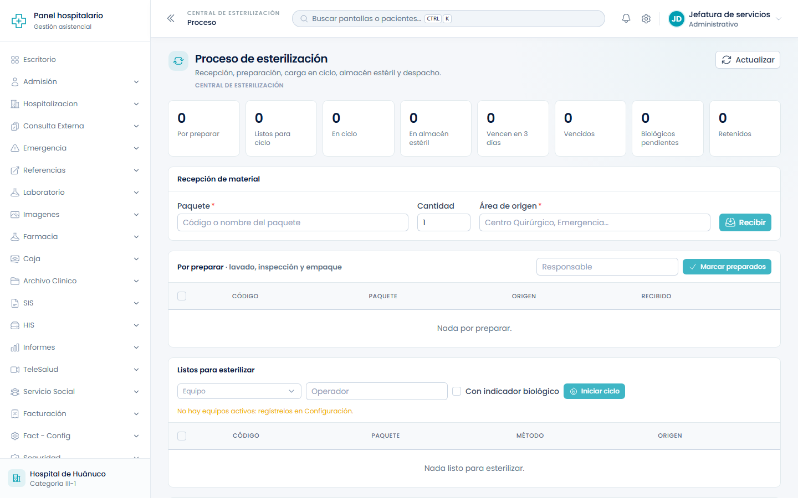

# 5. Central de Esterilización

La Central recibe el material usado, lo prepara, lo esteriliza, lo almacena y lo despacha, y **registra cada unidad** para saber en qué ciclo se esterilizó, hasta cuándo es válida y en qué paciente se usó.

Recibir›
Preparar›
Ciclo›
Almacén estéril›
Despachar y usar

## 5.1 Equipos y paquetes (configuración)

Ruta: **Central de Esterilización › Equipos y Paquetes**. Se configuran una vez.

| Qué | Campos |
|---|---|
| **Equipo esterilizador** (*Nuevo equipo*) | **Código** y **Nombre** (obligatorios), **Método** de esterilización (obligatorio) y **Ubicación**. |
| **Paquete** (*Nuevo paquete*) | **Código** y **Nombre** (obligatorios), **Tipo** (incluye *Implante*), **Método**, **Vigencia (días)** —el tiempo que el paquete se considera estéril en almacén— y **Contenido**. |

Con **Editar** se corrige, con **Guardar** se confirma y se puede activar o desactivar. Un código repetido se rechaza: *Ya existe un … con el código …*. Un equipo o paquete inactivo no se puede usar (*El paquete está inactivo*, *El equipo está inactivo*).

## 5.2 Proceso

Ruta: **Central de Esterilización › Proceso**. Recorre el material por sus etapas; los **indicadores** cuentan las unidades **Por preparar**, **Listos para ciclo**, **En ciclo**, **En almacén estéril**, las que **Vencen en 3 días**, las **Vencidas**, los **Biológicos pendientes** y los **Retenidos**.

<figure class="captura">

<figcaption>Figura 4. Proceso de esterilización.</figcaption></figure>

<ol class="pasos">
<li><strong>Recepción de material:</strong> pulse <strong>Recibir</strong> y elija el <strong>Paquete</strong>, la <strong>Cantidad</strong> y el <strong>Área de origen</strong> (obligatoria). Cada unidad recibe un código.</li>
<li><strong>Preparación:</strong> marque las unidades lavadas y armadas y pulse <strong>Marcar preparados</strong>. Quedan <em>Listos para esterilizar</em>.</li>
<li><strong>Ciclo:</strong> seleccione las unidades, elija el equipo y pulse <strong>Iniciar ciclo</strong>.</li>
<li><strong>Almacén estéril:</strong> las unidades con ciclo aprobado quedan disponibles. Con <strong>Despachar</strong> se entregan a su <strong>Destino</strong>.</li>
<li><strong>Vencidos o retenidos:</strong> pulse <strong>Reprocesar</strong> para volver a procesar las unidades vencidas o retenidas por un indicador biológico positivo.</li>
</ol>

| Regla | Mensaje |
|---|---|
| Las unidades deben estar en la etapa correcta. | *Unidades en otro estado: …* |
| El método debe corresponder al equipo. | *Estas unidades no se esterilizan por …* |
| Un equipo no abre dos ciclos a la vez. | *El equipo tiene un ciclo en proceso sin resultado* |
| Una carga con implantes necesita biológico. | *Una carga con implantes requiere indicador biológico* |
| No se despacha material vencido. | *Unidades vencidas, deben reprocesarse: …* |

## 5.3 Ciclos y resultado

Ruta: **Central de Esterilización › Ciclos**. La lista muestra Ciclo, Equipo, Unidades, **Indicadores** y Estado. **Abrir** un ciclo para registrar su **resultado**:

| Campo | Descripción |
|---|---|
| Temperatura (°C), Presión y Tiempo de exposición (min) | Parámetros del ciclo. |
| Indicador físico | Obligatorio: **No se hizo**, **Conforme** o **No conforme**. |
| Indicador químico | Obligatorio, con las mismas opciones. |
| Bowie-Dick | Solo para esterilizadores a vapor: *La prueba de Bowie-Dick solo aplica a esterilizadores a vapor*. |
| Observaciones | Notas. |
| Biológico | **Negativo** o **Positivo**, cuando llegue su resultado. |

Pulse **Registrar resultado**. Qué ocurre:

- **Ciclo rechazado** (algún indicador no conforme): se muestra el motivo y *las unidades vuelven a «listos para esterilizar»*.
- **Indicador biológico positivo:** la carga pasa a **cuarentena** y sus unidades quedan **retenidas**.
- **Contiene implantes:** *se libera cuando el indicador biológico salga negativo*. **Solo se libera con indicador biológico negativo.**

Un ciclo con resultado ya registrado no se modifica: *El ciclo ya tiene resultado registrado*.

## 5.4 Trazabilidad

Ruta: **Central de Esterilización › Trazabilidad**. Permite seguir cada unidad.

<ol class="pasos">
<li>En <strong>Buscar unidad</strong>, escriba el <strong>Código de la unidad</strong> y pulse <strong>Buscar</strong>: verá su paquete, su ciclo, su vencimiento y dónde se usó.</li>
<li>Para registrar su uso, pulse <strong>Registrar uso en paciente</strong>, elija la <strong>Cirugía</strong> y el <strong>Paciente</strong> (obligatorios) y pulse <strong>Registrar uso</strong>.</li>
<li>Si una unidad ya no debe usarse, pulse <strong>Devolver a reproceso</strong>.</li>
</ol>

El **Historial** lista los usos registrados.

| Regla | Mensaje |
|---|---|
| El código debe existir. | *No existe una unidad con ese código* |
| La unidad debe estar disponible. | *La unidad … no está disponible para uso (…)* |
| La unidad no debe estar vencida. | *La unidad … venció el …; no debe usarse* |
| La cirugía no debe estar suspendida. | *La cirugía está suspendida* |
