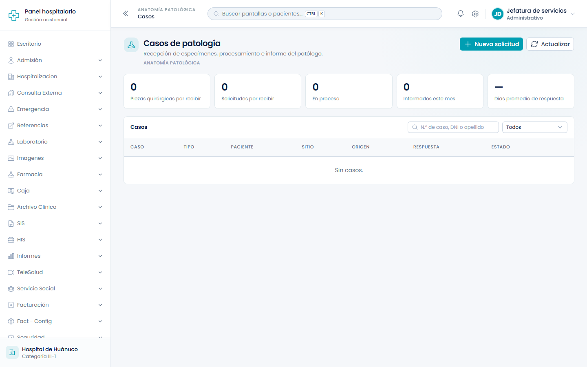

# 6. Anatomía Patológica

Recibe las muestras, las procesa y emite el **informe del patólogo**. Una muestra llega de dos formas: **enviada desde una cirugía** o por una **solicitud directa**.

Recepción›
Macroscopía y bloques›
Láminas›
Informe firmado

## 6.1 Lista de casos

Ruta: **Anatomía Patológica › Casos** (*Recepción de especímenes, procesamiento e informe del patólogo*).

<figure class="captura">

<figcaption>Figura 5. Casos de patología.</figcaption></figure>

- **Indicadores:** Piezas quirúrgicas por recibir, Solicitudes por recibir, **En proceso**, **Informados este mes** y **Días promedio de respuesta**.
- **Piezas quirúrgicas enviadas desde Centro Quirúrgico:** tabla con Cirugía, Paciente, Procedimiento, Muestra, Cirujano y Fijador. **Abrir caso** crea el caso de esa pieza.
- **Casos:** tabla con Caso, Tipo, Paciente, Sitio, Origen, Respuesta y Estado.

Solo se abre el caso de una cirugía con **muestra enviada e informe operatorio firmado** (*La cirugía no tiene una muestra enviada con informe operatorio firmado*), y una muestra tiene **un solo caso** (*La muestra de esta cirugía ya tiene caso*).

## 6.2 Nueva solicitud

Ruta: **Anatomía Patológica › Nueva Solicitud** (*Biopsia, pieza quirúrgica, citología o necropsia*).

| Campo | Obligatorio | Descripción |
|---|:-:|---|
| Paciente | Sí | Paciente del estudio. |
| Tipo de estudio | No | **Biopsia**, **Pieza quirúrgica**, **Citología** o **Necropsia**. |
| Prioridad | No | **Rutina** o **Urgente**. |
| Sitio anatómico | Sí | De dónde se tomó la muestra. |
| Médico solicitante | Sí | Quien pide el estudio. |
| Datos clínicos y Diagnóstico presuntivo | No | Orientan al patólogo. |
| Autorización, Autorizado por y Documento | Según el caso | Para estudios que lo requieren (por ejemplo, necropsia: familiar, fiscal u otra). |

En **Especímenes**, pulse **Agregar espécimen** por cada muestra: **Descripción** (obligatoria), **Recipiente** y **Fijador**. Use **Quitar** para retirar una. Pulse **Registrar solicitud**.

## 6.3 Procesar un caso

Abra el caso con **Abrir**. Hay cuatro etapas, que se completan en orden:

<ol class="pasos">
<li><strong>Recepción de especímenes:</strong> para cada espécimen (por letra), pulse <strong>Recibir conforme</strong> o <strong>Rechazar</strong> con su motivo. Un espécimen ya recibido o rechazado no vuelve a decidirse (*El espécimen … ya fue …*).</li>
<li><strong>Macroscopía y bloques:</strong> pulse <strong>Registrar macroscopía</strong>, escriba la <strong>Descripción macroscópica</strong> y el <strong>Responsable</strong> (obligatorios) y agregue los bloques de cada espécimen. Solo se tallan bloques de especímenes <strong>recibidos</strong> de este caso, y antes no puede haber especímenes pendientes de recepción (*Hay especímenes pendientes de recepción*).</li>
<li><strong>Bloques, láminas y archivo:</strong> para cada bloque anote su <strong>Ubicación</strong> y use <strong>Agregar láminas</strong>.</li>
<li><strong>Informe:</strong> escriba la <strong>Descripción microscópica</strong>, la <strong>Clasificación citológica</strong> (en citología), el <strong>Diagnóstico</strong>, el <strong>Diagnóstico codificado (CIE-10)</strong> y un <strong>Comentario</strong>. Pulse <strong>Guardar borrador</strong> o <strong>Firmar informe</strong>.</li>
</ol>

!!! important "Importante"
    El informe se firma con el **PIN** del patólogo, y para ello su cuenta debe estar vinculada a su ficha de personal (*Su usuario no está vinculado a una ficha de personal para firmar*). Si falta algo: *Complete antes de firmar: …*. **Informe PDF** solo se emite después de firmar (*El informe se emite después de firmarlo*).
