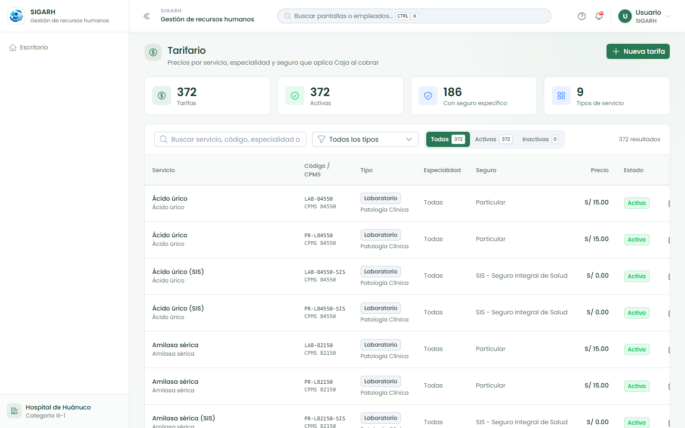

# 5. Configuración financiera

## 5.1 Seguros

Ruta: **Config. Financiera › Seguros** (*Seguros y convenios del hospital*). La lista muestra Seguro, RUC, Tipo, Cobertura y Estado, con los indicadores Total seguros, Activos, Inactivos y Tipos diferentes.

| Campo | Obligatorio | Descripción |
|---|:-:|---|
| Nombre del seguro | Sí | Ej.: *Seguro Integral de Salud*. *El nombre del seguro es requerido*. |
| RUC | Sí | **11 dígitos válidos**. *El RUC debe tener 11 dígitos*. |
| Tipo | Sí | **SIS**, **EsSalud**, **SOAT**, **Privado**, **Convenio** o **Particular**. |
| Cobertura (%) | Sí | Porcentaje de **0 a 100**. *El porcentaje debe estar entre 0 y 100*. |
| Contacto, Teléfono y Dirección | No | Datos de la aseguradora. |
| Seguro activo | — | Los seguros inactivos no estarán disponibles. |

!!! tip "Consejo"
    Verifique el RUC y el porcentaje de cobertura: un error se traslada a la facturación y a la atención.

## 5.2 Cajas

Ruta: **Config. Financiera › Cajas** (*Cajas de cobro del hospital*). Indicadores: Cajas, Activas, **Abiertas** y **Sin cajero asignado**. Tabla: Caja, Código, Ubicación, Cajero, Estado y Activa.

| Campo | Descripción |
|---|---|
| Nombre | Ej.: *Caja Central*. |
| Código | Ej.: *CAJ-01*. Use uno corto. |
| Ubicación | Ej.: *Hall de admisión*, para que el personal identifique la caja. |
| Cajero responsable | Se elige del **personal registrado** (SIG-01). Por defecto *Sin asignar*. |
| Estado | **Cerrada** o **Abierta**. |
| Monto de apertura (S/) | Dinero con el que se abre la caja. |
| Descripción | Detalle opcional. |
| Caja activa | Las inactivas **no se pueden abrir** para cobrar. |

!!! important "Importante"
    **La caja se abre y cierra por turno desde el HIS** (módulo Caja, manual HIS-09), no desde aquí. Si el cajero elegido no existe en el hospital, el sistema responde *El cajero indicado no existe en este hospital.*

## 5.3 Tarifario

Ruta: **Config. Financiera › Tarifario** (*Precios por servicio, especialidad y seguro que aplica Caja al cobrar*).

<figure class="captura">

<figcaption>Figura 4. Tarifario.</figcaption></figure>

- **Indicadores:** Tarifas, Activas, Con seguro específico y Tipos de servicio. Pestañas **Todas**, **Activas** e **Inactivas**, con el filtro **Todos los tipos**.
- **Tabla:** Servicio, Código / CPMS, Tipo, Especialidad, Seguro, Precio y Estado.

!!! tip "Consejo"
    Cree primero la tarifa **general** (sin seguro ni especialidad) de cada servicio y después las específicas: así Caja siempre encuentra un precio.

### Crear una tarifa

Pulse **Nueva tarifa** (*Define un precio que Caja aplica al cobrar*).

| Campo | Obligatorio | Descripción |
|---|:-:|---|
| Servicio | Sí | Descripción del servicio. Ej.: *Consulta externa - Medicina Interna*. Si falta: *Ingrese la descripción del servicio.* |
| Código | No | Código interno de la tarifa. |
| Tipo de servicio | No | **Consulta externa**, **Emergencia**, **Laboratorio (por examen)**, **Imágenes (por estudio)**, **Estancia hospitalaria (por día)**, **UCI / Intermedios (por día)**, **Cirugía (por acto)**, **Parto (por acto)**, **Procedimiento** u **Otros**. Por defecto, *Consulta externa*. |
| Examen de laboratorio / Estudio de imágenes | Según el tipo | Al elegirlo se proponen su nombre y su precio de catálogo. |
| Código CPMS (MINSA) | No | Ej.: *99203*. |
| UPSS | No | Por defecto *Sin UPSS*. |
| Especialidad | No | Por defecto *Todas (tarifa general)*. |
| Seguro / financiador | No | Por defecto *Particular / sin seguro*. **Cada tarifa aplica a un solo pagador**: para SIS, EsSalud y particular cree una tarifa por cada uno. |
| Precio (S/) | No | Importe de la tarifa, con decimales (por defecto 0). |
| Tarifa activa | — | **Solo las activas las aplica Caja.** |

### Cómo la aplica Caja

| Tipo de servicio | Regla de cobro |
|---|---|
| Consulta externa, Emergencia y demás | Caja busca primero la tarifa que coincide con **especialidad y seguro**, luego solo **seguro**, luego solo **especialidad** y al final la **general**. |
| Laboratorio e Imágenes | Primero la tarifa del **seguro de la orden**, luego la **general** (sin seguro). Si el examen no tiene tarifa, se usa el **precio de su catálogo**. |
| Estancia hospitalaria y UCI / Intermedios | Se cobra **por día-cama** de la cuenta del internamiento: el día del alta no se cuenta y el mínimo es **un día**. Mientras el paciente sigue internado, el cargo es **provisional**. |
| Procedimiento | Caja cobra el procedimiento con la tarifa cuyo **código o código CPMS** coincide con el código del procedimiento en *General › Tiempos de procedimientos* (capítulo 7). |
| Tipos que Caja no cobra automáticamente | Quedan registrados en el catálogo de servicios. |

| Regla | Mensaje |
|---|---|
| Los exámenes solo se tarifan con su tipo. | *Un examen de laboratorio solo se tarifa con el tipo Laboratorio.* / *Un estudio de imágenes solo se tarifa con el tipo Imágenes.* |
| Falta elegir el examen o estudio. | *Seleccione el examen de laboratorio de esta tarifa.* |
