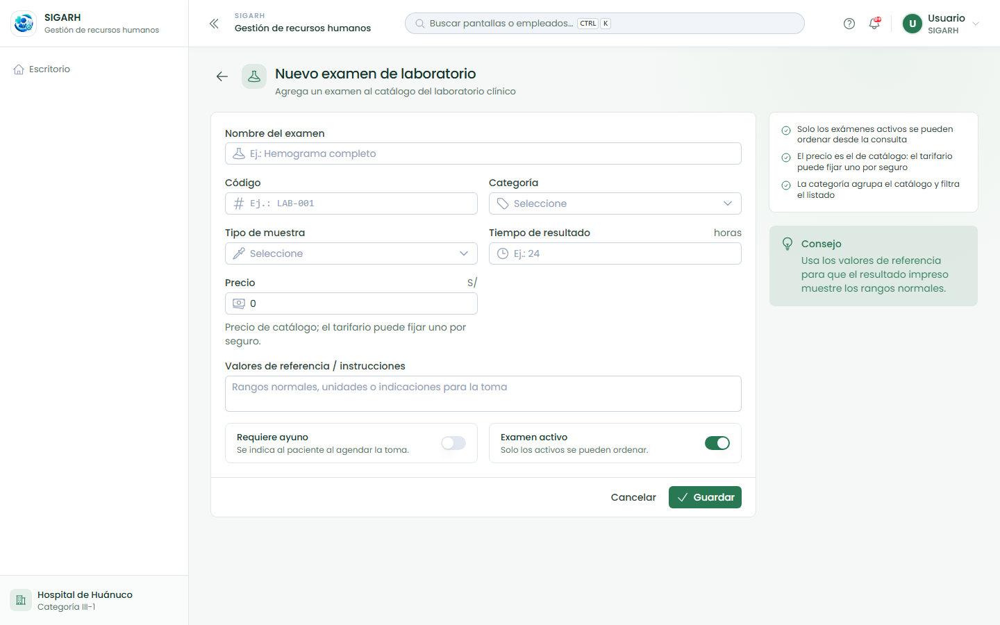

# 6. Laboratorio e Imagenología

Los **catálogos de exámenes** definen qué pueden ordenar los médicos desde la consulta. Solo los **exámenes activos** se pueden ordenar. El precio de catálogo puede sustituirse por el del tarifario (capítulo 5).

## 6.1 Exámenes de laboratorio

Ruta: **Laboratorio › Exámenes de Laboratorio** (*Catálogo de exámenes de laboratorio clínico*). Indicadores: Exámenes en el catálogo, Categorías, Activos y Requieren ayuno (los dos últimos, de la página). Tabla: Examen, Código, Categoría, Muestra, Precio y Estado. Filtros: búsqueda y **Todas las categorías**.

<figure class="captura">

<figcaption>Figura 5. Nuevo examen de laboratorio.</figcaption></figure>

| Campo | Descripción |
|---|---|
| Nombre del examen | Ej.: *Hemograma completo*. |
| Código | Ej.: *LAB-001*. |
| Categoría | **Hematología**, **Bioquímica**, **Microbiología**, **Inmunología**, **Uroanálisis**, **Parasitología**, **Endocrinología**, **Toxicología** u **Otros**. Agrupa el catálogo y filtra el listado. |
| Tipo de muestra | **Sangre**, **Orina**, **Heces**, **Esputo**, **Líquido cefalorraquídeo** u **Otros**. |
| Tiempo de resultado (horas) | Ej.: *24*. |
| Precio (S/) | Precio de catálogo. |
| Requiere ayuno | Se indica al paciente al agendar la toma. |
| Valores de referencia / instrucciones | Rangos normales, unidades o indicaciones para la toma. |
| Examen activo | Solo los activos se pueden ordenar. |

!!! tip "Consejo"
    Registre los **valores de referencia**: así el resultado impreso muestra los rangos normales.

## 6.2 Exámenes de imagenología

Ruta: **Imagenología › Exámenes de Imagenología** (*Catálogo de Diagnóstico por Imágenes*).

| Campo | Descripción |
|---|---|
| Nombre del examen | Ej.: *Radiografía de tórax PA*. |
| Código | Ej.: *IMG-001*. |
| Modalidad | **Radiografía**, **Ecografía**, **Tomografía**, **Resonancia magnética**, **Mamografía**, **Densitometría**, **Fluoroscopía** u **Otros**. |
| Región anatómica | Ej.: *Tórax*, *Abdomen*, *Cráneo*. |
| Duración del examen (minutos) | Se usa para **planificar la agenda del equipo**. |
| Precio (S/) | Precio de catálogo. |
| Requiere contraste | Se advierte al programar el estudio. |
| Preparación | Indicaciones previas para el paciente. |
| Examen activo | Solo los activos se pueden ordenar. |

!!! tip "Consejo"
    Describa la **preparación** con instrucciones claras para el paciente: ayuno, vejiga llena, retiro de metales.
